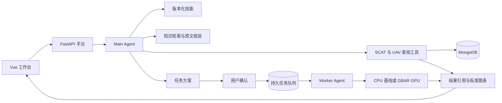

# SCAT Hermes Platform

**面向航空研究的 Agent 分析工作台。** 用自然语言查询 SCAT 航迹与 UAV 传感器数据，在地图中回放和分析轨迹，把预测与模型对比提交为可确认、可追踪的后台任务。

[功能概览](#功能概览) · [操作示例](#操作示例) · [系统架构](#系统架构) · [本地运行](#本地运行) · [开发入口](#开发入口)

## 功能概览

| 场景       | 工作台能力                                                                                         |
| ---------- | -------------------------------------------------------------------------------------------------- |
| 数据探索   | 按批次、航班、机场和质量条件检索 SCAT 数据，查看 UAV 架次、传感器通道与时序统计。                  |
| 轨迹分析   | 在二维街道底图和 Cesium 三维场景中查看轨迹，支持定位、回放、全屏和历史结果恢复。                   |
| 预测与实验 | 使用匀速或 Kalman 基线，以及已登记的 GBAR GPU 模型，执行未来预测、历史回测、同样本比较与重复实验。 |
| 结果交付   | 在同一工作台查看指标、表格、轨迹、分类与预测结果。支持表头排序、CSV 导出和展示配置恢复。           |
| 知识问答   | 检索航空术语、指标定义与业务规则，依据回读的原文证据生成带引用回答。                               |
| 技能管理   | 按版本加载业务技能，支持草稿修订、隔离试跑、审核发布和版本回滚。                                   |

## 操作示例

**从查询到可视化。** 先按呼号或批次定位航班，然后输入「绘制这架航班的二维轨迹，展示数据来源」。工作台用查询回执生成地图图层，并提供三维视图和原始证据入口。

**从方案到预测报告。** 对已选航班输入「用最后 200 个观测点，预测从末点开始未来 10、30、60 秒的轨迹」。查看数据窗口、模型版本和运行范围，确认后跟踪任务状态。完成后在结果页查看预测轨迹、覆盖范围及可用评估，按需导出表格。

**从历史结果继续分析。** 从会话历史打开已保存的结果，调整表格排序或图表布局。保存展示配置后，再次打开时可恢复相应视图。

## 系统架构



- **Agent 编排。** Main 读取技能并组织查询、解释和任务方案。Worker 依据批准快照执行操作。Author 负责技能草稿与试跑，发布由管理端确认。
- **可追踪的执行。** 确认时固定数据范围、模型、技能和预算。任务以稳定试验标识传递制品，后台使用租约管理执行权，页面可查进度和已保存结果。
- **统一的结果协议。** `AnalysisResult` 将指标、表格、时序和轨迹等业务结果交给相应渲染器。页面以受控引用读取结果，并保留来源、观测范围和评估口径。
- **研究口径。** 未来预测按固定观测窗口和目标时刻运行。历史回测使用可配对真值计算误差，并记录样本覆盖与排除原因。

**技术栈** · Python · FastAPI · Hermes Agent · MCP · MongoDB · SQLite · Vue 3 · TypeScript · ECharts · Cesium · Docker · NVIDIA CDI

## 本地运行

准备 Python 3.12–3.14 的项目 Conda 环境、Node.js 24、npm 11，以及符合数据契约的 MongoDB。依赖定义见 [pyproject.toml](pyproject.toml) 和 [前端锁文件](frontend/package-lock.json)。

1. 从 [`.env.example`](.env.example) 创建本机 `.env`，配置数据连接及需要的模型服务。配置项见[配置说明](docs/CONFIGURATION.md)。
2. 在已有项目 Python 环境中启动确定性数据 API。

   ```bash
   python -m uvicorn service.scat_only:app --app-dir src --host 127.0.0.1 --port 8080
   ```

3. 启动前端开发服务，通过 Vite 地址打开工作台。`/api` 默认代理到 `127.0.0.1:8080`。

   ```bash
   npm --prefix frontend ci
   npm --prefix frontend run dev
   ```

要运行自然语言对话、后台任务和技能管理，请接入固定版本的原生 Hermes 运行时，并将前端连接到完整平台 API。部署依赖和启动入口见 [Hermes 服务说明](services/hermes/README.md) 与[部署指南](docs/DEPLOYMENT.md)。

## 开发入口

| 目录                                           | 内容                                         |
| ---------------------------------------------- | -------------------------------------------- |
| [`src/service`](src/service)                   | FastAPI 路由、会话与任务接口、身份及结果归属 |
| [`src/hermes_runtime`](src/hermes_runtime)     | 原生 Agent 适配、技能加载、RAG 和结果回执    |
| [`src/workflow_runtime`](src/workflow_runtime) | 观测窗口、模型试验、评估、物化与报告         |
| [`skills`](skills)                             | 业务技能正文和参考资料                       |
| [`frontend`](frontend)                         | Vue 工作台、二维及三维可视化                 |
| [`tests`](tests)                               | API、权限、任务生命周期与业务契约测试        |

```bash
python -m pytest
npm --prefix frontend run check
npm --prefix frontend run test:e2e
```

接口契约见[会话 API](docs/api/hermes-conversations.openapi.json)与[记忆和 Agent 设置 API](docs/api/hermes-memory-settings.openapi.json)。技能版本和操作映射见[技能锁](services/hermes/skills.lock.json)与[工作流操作契约](services/hermes/workflow-operations.v1.json)。

## 来源与许可

项目持续开发，基于 [Agent Service Toolkit](https://github.com/JoshuaC215/agent-service-toolkit) 的业务实现扩展。源码许可与第三方来源见 [LICENSE](LICENSE) 和 [NOTICE](NOTICE.md)。运行所需的数据、模型权重和知识库由部署者提供。
