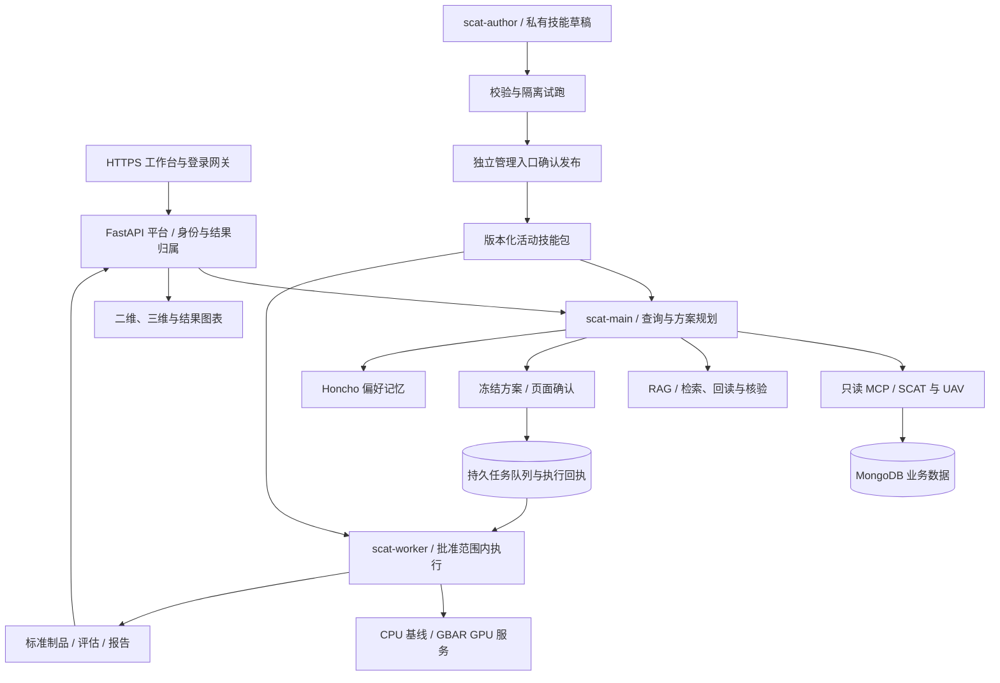

# SCAT Hermes Platform

面向 SCAT / UAV 航空数据的智能分析平台。通过自然语言查询、专业二维 / 三维轨迹展示，以及受控的 CPU / GPU 模型工作流，将数据查询、推理、评估和可回查报告连接起来。

**当前状态（2026-11-09）：核心业务主链路已实现并完成有限真实验收，具备 3 用户内网受控试运行基础。完整旧业务对等、独立回答质量与模型科学质量、长期 SLA 和最终分发许可仍有待完成。**

本仓库同步源码、测试、配置模板、部署脚本及项目文档。生产凭据、业务数据库、用户会话与记忆、模型权重、运行镜像及私有运行制品不随仓库分发。克隆仓库不等于恢复完整生产环境。

## 已实现的功能

| 范围         | 当前能力                                                                                                                        |
| ------------ | ------------------------------------------------------------------------------------------------------------------------------- |
| 自然语言查询 | SCAT 批次、航班、机场、数据质量、问题 / 合格航班、条件组合、分页及空结果后改查；UAV 航班、通道、采样和统计                      |
| 轨迹与图表   | 真实查询回执转换为标准 `AnalysisResult`；二维默认街道底图，三维定位到轨迹范围，支持全屏、移动端和刷新回读                       |
| 结果展示     | metrics、table、timeseries、trajectory_2d、classification、prediction、action_link 七类标准块；单主展示区、来源和分析范围可追溯 |
| 任务与队列   | 参数校验、冻结方案、页面确认、持久队列、独立后台 Agent、预算约束、租约与执行回执；状态未知时停止自动重放                        |
| 模型与实验   | CPU 运动基线与 GBAR GPU 接入；未来预测、历史回测、同样本模型对比、有限配置实验、物化、评估和报告                                |
| 预测契约     | 精确末尾点数窗口、从末点向未来预测；任意截止时间保留观测滞后；未来预测与历史回测分开，没有真值时不生成误差指标                  |
| 知识检索     | fast / deep / auto RAG，受控多 Agent 检索、原文回读、引用校验及证据不足状态                                                     |
| 技能生命周期 | 已发布技能按运行加载；依赖与缺失技能补加载；作者草稿、校验、隔离试跑、独立确认发布与回滚                                        |
| 记忆与身份   | Honcho 偏好记忆的召回、更正、删除和有限隔离验证；HYN / ZYJ 独立资源归属，admin 管理角色                                         |
| 部署         | 独立 HTTPS 门户保留旧站；CPU 核心服务容器化；GBAR 已切换到标准 Docker CDI 与固定 Conda 镜像                                     |

七类结果均有渲染能力和相关验证，但不能据此推断旧业务站所有查询、排序、导出和导航交互已完全对等。

## 系统结构



### Agent 与工具边界

| 角色          | 职责与工具                                                                                                             |
| ------------- | ---------------------------------------------------------------------------------------------------------------------- |
| `scat-main`   | 技能目录 / 正文读取，28 项业务只读 MCP，任务与工作流目录、方案准备、状态和制品读取。普通主对话不拥有批准任务的执行能力 |
| `scat-worker` | 基于批准快照使用技能读取工具、5 个兼容模型步骤或 8 个工作流操作；实际开放范围随任务收缩                                |
| `scat-author` | 仅 `skill_draft` 和只读 `profile_manage`；负责草稿、校验、试跑及经验候选整理，正式发布通过独立入口确认                 |
| RAG 按需角色  | fast 单 Agent；deep 协调者、两名研究者和一名回读核验者，按角色开放规划、委托、检索、回读和提交工具                     |

技能提供操作规范、契约和依赖，加载技能不会授予角色之外的权限。模型、数据、试验次数、预算和技能版本在任务批准时冻结。受限技能脚本入口需部署显式启用。

### 已发布技能

| 技能                        | 版本  | 用途                               |
| --------------------------- | ----- | ---------------------------------- |
| `scat-flight-query`         | 0.2.0 | SCAT 数据发现、批次与航班查询      |
| `aviation-knowledge`        | 0.2.0 | 航空知识检索及引用回答             |
| `scat-data-quality`         | 0.2.0 | 数据质量与问题 / 合格航班          |
| `scat-trajectory-analysis`  | 0.3.1 | 轨迹、FPL、CFPL、阶段和误差        |
| `uav-flight-analysis`       | 0.2.0 | UAV 航班、通道、采样与统计         |
| `scat-investigation`        | 0.2.0 | 跨查询、质量、轨迹和知识的组合调查 |
| `scat-model-analysis`       | 0.3.0 | 兼容模型任务的五步骤链路           |
| `scat-model-comparison`     | 0.3.1 | 同样本预测与模型对比               |
| `scat-experiment`           | 0.2.0 | 有限配置组合与重复试验             |
| `scat-data-materialization` | 0.1.0 | 统计、特征、阶段及预测指标物化     |
| `scat-evaluation`           | 0.2.0 | 评估汇总与失败 / 最差样本诊断      |
| `scat-report`               | 0.2.0 | 标准报告构建与实际回读             |

操作白名单、版本和依赖以 [skills.lock.json](services/hermes/skills.lock.json) 及部署活动包为准。角色说明见 [标准 Profiles](docs/HERMES_STANDARD_PROFILES.md)，工具与技能关系见 [技能生命周期](docs/HERMES_SKILLS_LIFECYCLE_AND_TOOL_MAPPING.md)。

## 目录结构

```text
src/
  application/       应用服务与只读业务入口
  hermes_runtime/    Hermes 适配、技能、任务、预算、RAG 与结果引用
  workflow_runtime/ 受控模型工作流与 GPU 接入
  service/           FastAPI 接口、认证、身份与资源归属
  scat/              SCAT 领域与数据访问
  agents/            保留的旧业务 Agent / 工具与兼容实现
frontend/            Vue 3 / TypeScript 工作台与 ECharts / Cesium 可视化
skills/              版本化业务技能正文
config/              非秘密配置与私有配置模板
services/            上游运行时锁、操作契约与服务配置
infra/               Compose、Nginx 和 systemd 部署材料
environments/        Conda 环境及固定依赖材料
scripts/             启停、部署、迁移、验收和维护脚本
tests/               后端自动化测试
evaluations/         固定评测输入与相关配置
authoring/           技能模板、开发草稿与说明
docs/                设计、实施、交接与验收记录
```

`var/` 保存本地或服务器的运行状态、制品与私有验收证据，已从 Git 排除。`vendor/hermes-agent/` 是外置固定上游源码，也不随本仓库上传。

## 环境与配置

### 运行前提

- Python 使用已有 Anaconda 环境。平台、原生 Hermes、GBAR 使用不同的固定环境，具体版本和制品以各部署锁为准；`pyproject.toml` 的平台范围为 Python 3.12–3.14。
- 前端使用 Node.js 24 和 npm 11，依赖锁为 `frontend/package-lock.json`。
- 真实查询需要已有 SCAT / UAV MongoDB 数据；自然语言功能还需要私有模型提供方配置。
- 原生 Hermes 固定上游提交为 `5b147ab036d6d19131bff8d20701b5001eab844a`，还原依据为 [上游锁](services/hermes/upstream.lock.json) 和 [源码清单](services/hermes/upstream.source.json)。
- GBAR 权重、模型专用源码 / 配置、GPU 制品及 RAG 权重 / 语料需独立提供并校验，不包含在源码快照中。

现有部署沿用固定 Conda / 离线制品，不使用项目内 venv、uv 或运行时自动安装依赖。仓库保留的 `uv.lock` 是历史依赖材料，不是当前部署入口。

### 私有配置

复制根目录 `.env.example` 为 `.env`，仅在本机或部署机器填写实际配置：

| 配置                                                                      | 用途                         |
| ------------------------------------------------------------------------- | ---------------------------- |
| `FLIGHT_MONGO_URI`、`FLIGHT_MONGO_DB`                                     | 业务数据库                   |
| `DEEPSEEK_API_KEY`、`DEEPSEEK_BASE_URL`、`DEFAULT_MODEL`                  | 当前模型提供方               |
| `AUTH_SECRET`                                                             | 平台内部认证                 |
| `ANALYSIS_IDENTITY_MODE`                                                  | 单用户开发或可信网关身份模式 |
| `HERMES_BASE_URL`、`HERMES_API_KEY_FILE`                                  | 原生 Hermes 服务连接         |
| `HERMES_STATE_FILE`、`HERMES_RESULT_STATE_FILE`、`HERMES_TASK_STATE_FILE` | 持久状态位置                 |

多用户门户使用可信网关身份与服务端资源归属校验。生产部署还需独立的网关、作者 / 发布凭据、记忆服务和 GPU 登记配置，不能仅复制 `.env.example` 就开放服务。详见 [配置说明](docs/CONFIGURATION.md)、[当前上线记录](docs/HERMES_RELEASE_READINESS_20261108.md) 及 `config/` 下的示例文件。

密钥不写入源码、README、`VITE_*`、URL、前端静态资源或提交记录。

## 开发与运行

以下命令只适用于已经还原依赖和私有配置的环境。首次部署先阅读对应文档；历史文档中的旧端口、旧停点和临时入口不代表当前生产状态。

### 只读数据 API

在项目根目录、已有平台 Conda 环境中执行：

```bash
PYTHONPATH=src python -m uvicorn service.scat_only:app --host 127.0.0.1 --port 8080
```

该入口用于确定性数据查询，不启动自然语言模型。完整 Hermes 平台入口为 `service.hermes_app:app`，还需原生 Hermes、后台队列与相关私有配置。

### 前端开发

在已有 Node / npm 及项目依赖的环境中执行：

```bash
cd frontend
npm run dev
```

Vite 默认将 `/api` 代理到 `http://127.0.0.1:8080`，可通过服务端变量 `SCAT_DEV_PROXY_TARGET` 调整；作者代理通过 `SCAT_AUTHOR_PROXY_TARGET` 配置。实际入口和联调约束见 [工作台记录](docs/HERMES_FRONTEND_WORKSPACE.md) 与 [最新上线记录](docs/HERMES_RELEASE_READINESS_20261108.md)。

### 已部署环境运维

CPU 容器及作者服务通过项目自有 Compose 管理脚本维护；以下命令只读取现有部署状态：

```bash
/home/h3c/anaconda3/envs/scat-agent/bin/python -B scripts/manage_container_deployment.py status --author
```

部署需要 `var/deploy/` 中的私有配置、镜像锁和持久状态。GBAR 的标准 CDI / Conda 切换、迁移一致性和回滚记录见 [最新上线记录](docs/HERMES_RELEASE_READINESS_20261108.md)。RAG 目前仍使用宿主既有 Conda 服务，尚未一并迁入固定容器。

## 验证与当前边界

最近一轮已记录：

- 后端完整回归 **1,525 passed / 2 skipped**；前端 **169** 项单元测试及桌面 / 手机浏览器检查。
- 真实自然语言查询、任意截止时间实验、物化及报告回读；真实 GBAR 制品、二维 / 三维 / 全屏及刷新恢复。
- 三身份网关、跨归属拒绝、合成偏好记忆召回 / 更正 / 删除，以及两份真实 GPU 任务串行执行并伴随管理员只读操作。
- GBAR 标准 CDI 与固定 Conda 镜像迁移；同一固定输入的新旧输出一致性验证。

这些是既有验收记录，不表示每次克隆都会执行或通过相同测试。完整原始运行证据在部署环境的 `var/validation/` 中，仓库中的文档和部分摘要用于索引。

开发环境检查入口：

```bash
# 已有平台测试环境，在项目根目录执行
python -m pytest

# 已有前端环境
cd frontend
npm run check
npm run test:e2e
```

真实数据、GPU、外部模型和登录浏览器验收需要独立环境与有限预算，不能用离线 fixture 的通过代替。具体失败和重测均保留在阶段记录中。

### 尚未完成的准入事项

1. 按 52 项语义矩阵继续验证旧业务边界及完整旧站交互，包括大批量、组合、分页、取消与失败恢复。
2. 独立 RAG 人工语义复核及未用于修复的题集准入。
3. GBAR 权重到训练划分的完整可追溯材料、按航班隔离的独立测试及科学质量评测；分类类别字典仍待核验。
4. 更长运行窗口、混合负载、冷 / 暖业务延迟和故障恢复 / SLA 验收。
5. 如纳入发布范围，完成 RAG 等宿主服务的固定环境容器迁移。
6. ZYJ / admin 的实际网页登录与角色运维验收，以及最终分发许可人工审查。

功能验收航班 `100002` 位于现有训练 CSV 分区，相关结果仅作功能、契约和迁移证据，不能作为独立泛化成绩。详细结论以 [上线条件审查](docs/RELEASE_READINESS_REVIEW_20261109.md) 为准。

## 建议阅读顺序

1. [上线条件审查与剩余门槛](docs/RELEASE_READINESS_REVIEW_20261109.md)
2. [最近一轮实施、失败重测及页面试用指令](docs/HERMES_RELEASE_READINESS_20261108.md)
3. [旧业务语义矩阵审计](docs/BUSINESS_SEMANTIC_AUDIT_20261109.md)
4. [模型全链路实现与验收](docs/HERMES_MODEL_FLOW_20261108.md)
5. [预测窗口与未来预测契约](docs/HERMES_FORECAST_CONTRACT_20261107.md)
6. [标准 Agent Profiles](docs/HERMES_STANDARD_PROFILES.md) 与 [技能生命周期](docs/HERMES_SKILLS_LIFECYCLE_AND_TOOL_MAPPING.md)
7. [CPU 容器部署基线](docs/HERMES_H7B_CONTAINER_DEPLOYMENT.md) 与 [最新部署变更](docs/HERMES_RELEASE_READINESS_20261108.md)
8. [开发计划与纪律](SCAT_HERMES_PLATFORM_DEVELOPMENT_AND_TEST_PLAN.md)

文档按日期保留开发过程。遇到历史结论与当前状态不同，先核对最新审查和实施记录；不使用测试数量或映射覆盖率推算完成百分比。原根目录 README 的阶段内容见 [README 历史归档](docs/README_HISTORY_20261109.md)。

## 来源与许可

项目选择性复用既有 SCAT 航空分析平台业务实现，基础来源为 [Agent Service Toolkit](https://github.com/JoshuaC215/agent-service-toolkit)，保留原 [MIT LICENSE](LICENSE) 与 [NOTICE](NOTICE.md)。Hermes Agent 和其他依赖遵守各自许可。

源码许可不自动覆盖模型权重、业务数据、知识库、GPU 用户态库或捆绑第三方制品。相关材料不随本次源码同步上传，完整分发许可审查仍待人工结项。
