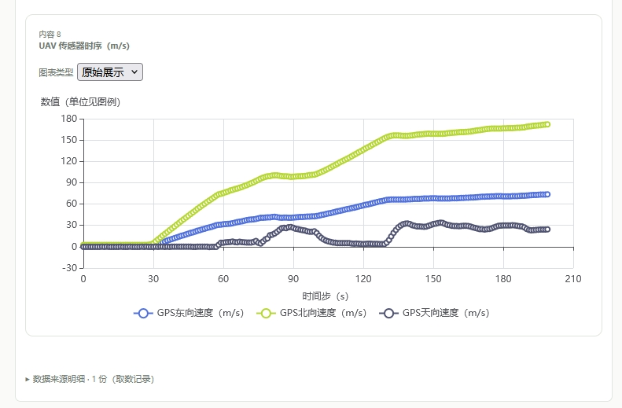
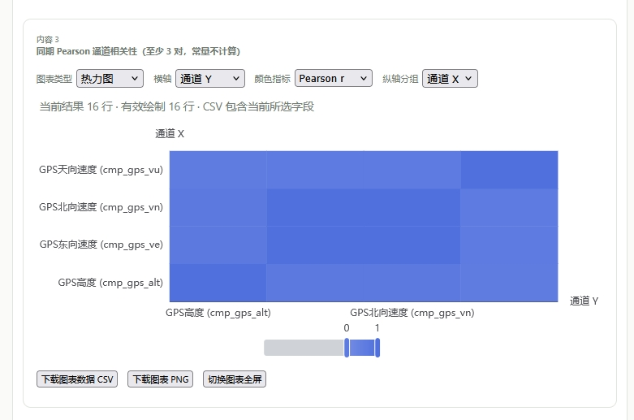
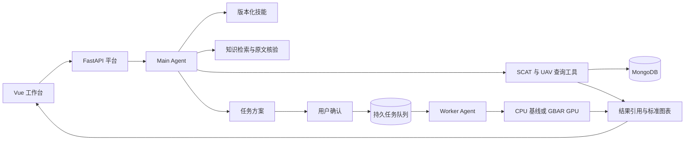

# SCAT Hermes Platform

**可自部署的航空数据分析工作台。**

[快速开始](#快速开始) · [操作示例](#操作示例) · [配置文档](docs/CONFIGURATION.md) · [部署指南](docs/DEPLOYMENT.md)

---

SCAT Hermes Platform 把飞行数据查询、轨迹分析和模型实验放在同一个工作台。用自然语言定位 SCAT 批次、航班或 UAV 架次，查看数据来源和样本范围，再用表格、图表和地图验证结果。需要预测或对比模型时，可以先确认输入窗口和运行参数，再由后台队列执行。

**SCAT** 提供航班元数据、实飞轨迹和可用的 CFPL 计划航路，适合做批次趋势、质量检查和航路误差评估。**UAV** 提供 GPS、速度、姿态和惯性等机载传感器通道，适合分析同一架次的时序、相关性和阶段分布。

| 可以做什么 | 工作台提供什么 |
| --- | --- |
| 检查 SCAT 批次与航班 | 查看计划航班量、机型与机场分布，筛选质量问题，打开二维地图和 Cesium 三维回放。 |
| 分析 UAV 多通道数据 | 按原始样本窗口比较时序、同期相关性和分阶段分布，查看有效样本数。 |
| 评估航路和预测 | 按时域、阶段或机型查看 CFPL 计划与实飞误差，回查误差最大的匹配样本。 |
| 运行模型实验 | 使用匀速、Kalman 基线或已登记的 GBAR GPU 模型，运行未来预测、历史回测和同样本模型对比。 |
| 复用分析结果 | 切换图表、字段和分组，保存展示设置，导出 CSV 或 PNG，并从历史会话回读结果。 |
| 查询知识与管理技能 | 核对航空术语和规则的原文引用，按版本管理技能草稿、隔离试跑、审核发布和回滚。 |

## 快速开始

### 本地数据浏览

准备 Python 3.12–3.14 Conda 环境、Node.js 24、npm 11，以及已导入 SCAT 航班数据的 MongoDB。根据 [`.env.example`](.env.example) 创建项目根目录的 `.env`，填写 `FLIGHT_MONGO_URI` 和 `FLIGHT_MONGO_DB`。[依赖定义](pyproject.toml) · [配置说明](docs/CONFIGURATION.md)

在已激活的 Conda 环境中，从仓库根目录安装依赖并启动数据 API。

```bash
python -m pip install -e .
python -m uvicorn service.scat_only:app --app-dir src --host 127.0.0.1 --port 8080
```

在另一个终端启动前端。

```bash
npm --prefix frontend ci
npm --prefix frontend run dev
```

打开 Vite 输出的地址，进入「数据浏览」。前端默认将 `/api` 转发到 `127.0.0.1:8080`。

### 完整 Agent 工作台

对话和后台任务需要固定版本的原生 Hermes、语言模型连接和平台状态目录。按运行时文档准备 `scat-main`、`scat-worker` 和 `scat-author`，启动完整平台 API `service.hermes_app:app`，并将前端的 `SCAT_DEV_PROXY_TARGET` 指向该服务。团队部署可按 Compose 配置接入认证网关和后台任务服务。[Hermes 运行时](services/hermes/README.md) · [部署指南](docs/DEPLOYMENT.md)

## 操作示例

### UAV 多通道时序与分布

> 对已选 UAV 架次读取连续 200 个原始样本，分析 GPS 高度和东向、北向、天向速度，展示时序、同期相关性及分阶段分布。

折线对照同一窗口内三个速度分量的变化。通过「查看数据」可核对采样范围，结果可以导出为 CSV 或 PNG。



<details>
<summary>查看同一窗口的阶段箱线图与相关性热力图</summary>

箱线图展示各速度分量的中位数、四分位数和极值。


Pearson 热力图展示 GPS 高度与三个速度分量的同期配对相关性。



</details>

### SCAT 轨迹回放

> 绘制当前 SCAT 航班的二维轨迹，并展示数据来源和轨迹覆盖范围。

结果区可切换二维底图和三维跟随视图，并使用时间轴回放。

| 二维轨迹回放                                                                                   | 三维跟随视图                                                                                        |
| ---------------------------------------------------------------------------------------------- | --------------------------------------------------------------------------------------------------- |
|  |  |

### CFPL 航路误差

> 查询批次 `scat20161015_20161021` 已物化的 CFPL 误差，按水平误差从大到小返回前两条，列出航班、时域和误差（米），并说明样本覆盖范围。

也可以在「预测评估」页比较不同时域的误差、样本量和覆盖航班，再从「最差案例」查看对应的航班及匹配结果。

### 后台轨迹预测

> 用当前航班最后 200 个观测点，预测从末点开始未来 10、30、60 秒的轨迹。

核对数据窗口、模型版本和运行范围，确认后跟踪任务状态。完成后可从原会话打开预测轨迹和覆盖范围，或导出结果。

## 系统架构



- **Agent 编排。** Main 读取技能并组织查询、解释和任务方案。Worker 依据批准快照执行操作。Author 负责技能草稿与试跑，发布由管理端确认。
- **可追踪的执行。** 确认时固定数据范围、模型、技能和预算。任务以稳定试验标识传递制品，后台使用租约管理执行权，页面可查进度和已保存结果。
- **统一的结果协议。** `AnalysisResult` 将指标、表格、时序和轨迹等业务结果交给相应渲染器。页面以受控引用读取结果，并保留来源、观测范围和评估口径。
- **研究口径。** 未来预测按固定观测窗口和目标时刻运行。历史回测使用可配对真值计算误差，并记录样本覆盖与排除原因。

**技术栈** · Python · FastAPI · Hermes Agent · MCP · MongoDB · SQLite · Vue 3 · TypeScript · ECharts · Cesium · Docker · NVIDIA GPU

## 开发入口

| 目录                                           | 内容                                         |
| ---------------------------------------------- | -------------------------------------------- |
| [`src/service`](src/service)                   | FastAPI 路由、会话与任务接口、身份及结果归属 |
| [`src/hermes_runtime`](src/hermes_runtime)     | 原生 Agent 适配、技能加载、RAG 和结果回执    |
| [`src/workflow_runtime`](src/workflow_runtime) | 观测窗口、模型试验、评估、物化与报告         |
| [`skills`](skills)                             | 业务技能正文和参考资料                       |
| [`frontend`](frontend)                         | Vue 工作台、二维及三维可视化                 |
| [`tests`](tests)                               | API、权限、任务生命周期与业务契约测试        |

```bash
python -m pytest
npm --prefix frontend run check
npm --prefix frontend run test:e2e
```

接口契约见[会话 API](docs/api/hermes-conversations.openapi.json)与[记忆和 Agent 设置 API](docs/api/hermes-memory-settings.openapi.json)。技能版本和操作映射见[技能锁](services/hermes/skills.lock.json)与[工作流操作契约](services/hermes/workflow-operations.v1.json)。

## 来源与许可

项目持续开发，基于 [Agent Service Toolkit](https://github.com/JoshuaC215/agent-service-toolkit) 的业务实现扩展。源码许可与第三方来源见 [LICENSE](LICENSE) 和 [NOTICE](NOTICE.md)。运行所需的数据、模型权重和知识库由部署者提供。
