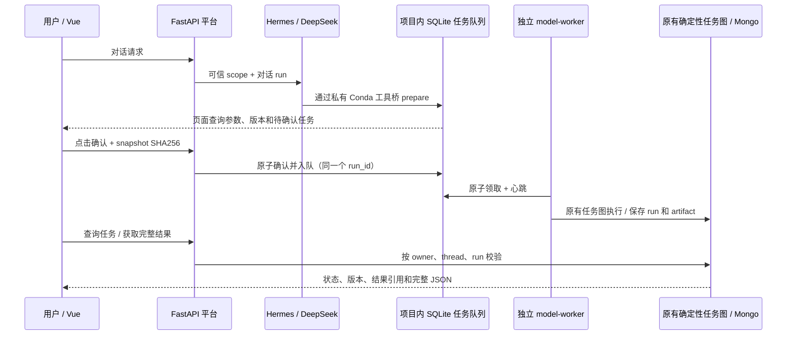

# H5：受控模型任务与确认闭环

本阶段在 Hermes 对话入口接回已有模型注册、确定性 LangGraph 任务图、Mongo run 和 AnalysisResult artifact。新增的是可信任务应用层、人工确认 API、持久化执行队列和独立 worker；模型算法、预处理、评估与结果协议继续复用。当前仅支持已配置的固定单用户，动态结果编排仍按 H6 计划推进。

2026-10-23 版本说明：本文保留旧 H5 已实现/已验收契约。主计划 v2.0 要求由原生 Skills 接管模型等核心流程，S3/S4 将替换 worker 到旧内部图的主链；确认、owner、租约、未知状态和历史结果语义继续复用。本文的“复用内部图”不代表新目标仍永久保留该调度方式，见 [新方案](HERMES_SKILLS_ARCHITECTURE_AND_REUSE_20261023.md)。

## 调用路径与服务环境



| 服务 | 环境与职责 |
| --- | --- |
| Nginx | 统一客户端入口，现有 `/api/` 路由覆盖 H5；正式切换留 H7 |
| Vue | 现有页面增加参数核对、明确确认、撤销未执行任务、状态刷新和完整结果 JSON 下载 |
| FastAPI | `scat-agent` Conda，Python 3.12，负责身份、确认、查询与结果授权 |
| Hermes | `scat-hermes` Conda，Python 3.14，外部 DeepSeek，受限工具白名单 |
| 私有任务工具桥 | Hermes 通过绝对路径调用 `scat-agent` Conda；JSON stdin/stdout，不使用 shell |
| model-worker | 独立 `scat-agent` Conda 进程，读取持久队列并复用确定性任务图 |
| 具体模型后端 | 沿用原项目独立环境/服务和已审核模型注册，不把 GPU 依赖装进 Hermes |
| SQLite / Mongo | SQLite 保存不可变准备快照、确认和领取状态；Mongo 保存既有 run 与 artifact |

本机和服务器均使用 Anaconda 内的环境，不在项目目录建立 venv。本阶段没有安装或升级依赖、发布 Nginx 或启用常驻服务。Compose 的正式服务编排与健康检查继续留 H7；将来容器化时，Hermes 工具桥、平台与 worker 必须访问同一持久状态卷，不能各有一份队列文件。当前队列适用于同一主机/共享本地卷，不支持多主机分布式调度。

## 复用与新增代码

- `application/model_tasks.py`：可信上下文、固定版本、准备摘要、确认校验和受归属控制的结果读取。
- `application/task_store.py`：SQLite 事务、确认摘要、幂等入队、原子领取、心跳与 unknown 阻断。
- `application/model_worker.py`、`scripts/run_model_worker.py`：独立 worker，执行前再次核对注册快照；执行调用既有 `_execute_persisted_model_run`，内部继续使用原有 model-agent 图。
- `service/model_task_api.py`：人工操作与状态/结果 API；沿用 Bearer、平台 thread registry 和 owner 规则。
- `hermes_runtime/task_bridge.py`、`scripts/run_model_task_tool.py`：固定 Hermes v0.22.3 原生工具注册适配；业务代码在 Python 3.12 子进程运行。
- `ModelTaskPanel.vue`：仅完成 H5 所需确认和恢复，不提前实现 H6 的七类动态展示渲染。

旧 `agents/model_tools.py`、模型包和分析结果构造函数仍是共用执行实现，当前作为兼容适配使用；没有复制模型算法或重新实现预处理和评估。

## Hermes 工具边界

原有五类只读 MCP 保留。开启 H5 后增加五个原生业务工具：

| 工具 | 功能 |
| --- | --- |
| `scat_task_catalog` | 查看已注册模型、版本、资源限制和可用性 |
| `scat_task_prepare` | 校验固定版本请求并保存待确认快照，不执行计算 |
| `scat_task_list` | 列出当前可信会话的任务 |
| `scat_task_get` | 查询当前会话任务和运行结果引用 |
| `scat_task_artifact` | 读取该任务的完整已保存分析结果，工具输出上限 64 KiB |

Hermes 没有确认、提交、任意 HTTP、终端或文件工具。聊天中“同意执行”不会提交任务；必须点击页面按钮或由已认证的客户端显式调用确认 API。原生会话 ID 由 Hermes 实际调度参数传入工具处理器，服务端绑定 scope 与来源 run；v0.22.3 实际分派不传 tool_call_id，同一可信 run 内用规范化参数摘要作准备幂等键。模型参数不能指定 owner、thread、scope、requested_by 或 confirmed。工具桥在平台 thread registry 中把 scope 解析回配置的 owner/thread，不能沿用只读 MCP 的固定 `mcp-readonly` 会话来确认模型任务。

准备时固定模型版本、评估器、组件版本、数据范围、参数、代码版本配置值和 Hermes 来源 run/thread；规范化 SHA256 覆盖整个快照。确认及领取时再次核对模型注册。未配置 `ANALYSIS_CODE_VERSION` 时沿用原默认值，不能把默认值当作源码发布版本证明。

## API

所有接口均要求现有 Bearer；thread 必须是平台为当前 owner 创建的 UUID。请求体禁止额外字段。

| 方法 | 路径（省略 `/api/v1/hermes`） | 说明 |
| --- | --- | --- |
| GET | `/model-catalog` | 当前注册模型 |
| POST | `/threads/{thread}/model-tasks` | `{request_id: UUID, proposal: ModelTaskRequest 的业务字段}` |
| GET | `/threads/{thread}/model-tasks` | 当前会话最近 50 个任务与状态 |
| GET | `/threads/{thread}/model-tasks/{task}` | 单任务、既有 Mongo run 和 artifact 引用 |
| POST | `/threads/{thread}/model-tasks/{task}/confirm` | `{confirmed: true, snapshot_sha256: 准备响应中的摘要}`，202 |
| POST | `/threads/{thread}/model-tasks/{task}/revoke` | `{}`，仅 pending 或尚未领取的 queued |
| GET | `/threads/{thread}/model-tasks/{task}/artifacts/{artifact}` | 校验 owner/thread/run、有效期、大小与哈希后返回完整结果 |

`proposal` 仅接受 task_type、model_key、model_version、input_ref/input_refs、parameters、evaluator。输入仍使用原有严格 ModelTaskRequest 校验，数据与模型限制由注册表决定。确认接口不接受参数覆盖。新 proposal 使用新的 request_id；相同 request_id 的相同准备请求返回原任务，参数变化返回冲突。

同一确认 ID 与摘要重复提交返回同一个 run，不能分配新 run 或重复执行。跨用户/跨会话返回 404，过期、撤销、摘要或注册变化返回 409，非法额外字段返回 422。

## 状态、故障与恢复

```text
pending --用户确认--> queued --独立 worker 领取--> claimed --核实终态--> finished
   |                    |                          |
   +--过期/撤销         +--尚未领取可撤销          +--中断/心跳过期/回执不明--> unknown
```

- 确认有效期 15 分钟，每个 scope 最多 50 个有效待确认任务。已确认任务不会因准备确认期过去而自动取消。
- H5 队列同时只允许一个 claimed；领取为 SQLite `BEGIN IMMEDIATE` 原子事务。多开 worker 不增加该队列并发；不会替其他旧入口建立主机级 GPU 锁。
- 心跳间隔 5 秒、租期 60 秒。worker 被强制终止后，经查询或下一次领取发现租期过期，任务进入 unknown；有任何 unknown 时阻止队列继续领取，避免遗留 GPU 作业与新作业重叠。
- 停止对话、关闭 SSE、页面刷新和平台重启均不取消已确认任务。worker 是独立服务；待领取任务在其启动后继续处理。
- 正常 SIGTERM 停止领取新任务并等待当前任务结束；强制中断或执行结果未核实按 unknown 处理，不自动重排。
- 执行失败保存既有 failed run；artifact 保存失败同样记录失败原因，均不自动重跑。模型已经执行但终态保存失败时，保留 run_id 并进入 unknown。
- 排队后模型注册发生变化，在开始模型计算前记录失败终态，要求重新准备和确认。
- `finished` 是队列的“终态已核实”，成功或失败以 `run.status` 为准。Mongo running 与队列 unknown 并存时，以“执行状态待核实”显示。

核对 Mongo 已有 succeeded/failed/cancelled 终态后，可运行下面的 reconcile 命令解除 unknown；命令只核验既有终态，不执行模型。没有终态时会拒绝恢复，必须人工检查外部作业和记录，不能删除队列条目或改成 queued 来重跑。

## 启动与验收

服务器项目目录：`/home/h3c/project/python/scat-hermes-platform`。使用绝对 Conda 路径，三个应用进程分开托管：

```sh
/home/h3c/anaconda3/envs/scat-hermes/bin/python -B scripts/run_hermes_api.py   --with-mcp --with-model-tasks --home var/hermes/single-user-h5
/home/h3c/anaconda3/envs/scat-agent/bin/python -B -m uvicorn service.hermes_app:app   --app-dir src --host 127.0.0.1 --port 18080
/home/h3c/anaconda3/envs/scat-agent/bin/python -B scripts/run_model_worker.py
```

H5 运行时使用新的 Hermes home，因为旧五工具 profile 与新十工具 profile 不同；启动器会拒绝直接覆盖不一致的旧配置。平台/工具桥/worker 的 `HERMES_STATE_FILE`、`HERMES_TASK_STATE_FILE` 和代码/模型配置必须一致；默认任务文件为项目内 `var/platform/model-tasks.sqlite`。该文件包含业务请求与元数据，应按私有状态保存、备份，不能当临时文件删除。

```sh
# 单次领取（没有待执行任务时退出）
/home/h3c/anaconda3/envs/scat-agent/bin/python -B scripts/run_model_worker.py --once
# 仅核实已有终态，不执行任务
/home/h3c/anaconda3/envs/scat-agent/bin/python -B scripts/run_model_worker.py   --reconcile <task_id> --thread <platform_thread_uuid>
# 普通 H5 测试（无需实际 Mongo/GPU；真实 Mongo 测试默认跳过）
/home/h3c/anaconda3/envs/scat-agent/bin/python -B -m pytest tests/hermes_runtime/test_model_task*.py tests/hermes_runtime/test_task_bridge.py -q
# 显式真实 Mongo 测试，只创建本轮随机隔离集合并 finally 清理
SCAT_H5_REAL_MONGO=1 /home/h3c/anaconda3/envs/scat-agent/bin/python -B -m pytest   tests/hermes_runtime/test_model_tasks.py -q
```

当前服务器 `SCAT_GBAR_V23_ENABLED=false`，生产模型目录为空。启用真实 GPU 前仍需按既有配置说明准备已审核源码、权重、后端环境与完整性摘要，再单独验收；本阶段不改动该开关。本轮真实调用和完整计算闭环使用明确标记的受控 CPU 夹具，不据此宣称 GBAR/V100 生产推理已通过。测试进程与夹具文件验证后清理，不作为常驻模型服务保留。

本轮测试证据与限制见 `docs/validation/20261022-H5-acceptance.md`；历史 H1–H4 验证文件保持原样。
