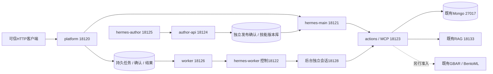

# H7-B 容器封装与部署记录（2026-10-27）

开发纪律与地址（开发前）：服务器 `/home/h3c/project/python/scat-hermes-platform` 优先，仅已有 Anaconda scat-agent/scat-hermes/scat-rag-train，宿主不新建环境、不用 venv/uv；镜像从这些环境的固定Conda/pip制品重建，不挂载宿主Conda目录。临时文件仅两端本项目 `.tmp/h7b` 与原子同步目录，结束清理；正式依赖制品/镜像输入/证据留项目 `var/deploy/h7b` 和 `var/validation/20261027-h7b`。Docker自身镜像层由既有 `/var/lib/docker` 管理，不改daemon/驱动、不清理他人镜像。

地址：保留旧80/443/8080/8501/8091/27017、本项目正式18081/18133与旧GBAR容器；候选均回环：18120平台、18121主Hermes、18122后台Hermes控制面、18123 MCP/受控动作、18124作者API、18125作者Hermes、18126 worker健康；GPU配置预留18127 GBAR/18134 RAG，未通过前不启动。外部模型 https://api.deepseek.com。Key仅服务器私有文件/挂载，不打印、COPY入镜像或下载本机。

用户授权：按已讨论Docker/Compose方案进行部署封装、记录日志，并在完成后总结每个容器配置。CPU核心五服务优先，RAG与GBAR独立可选GPU服务、作者两服务按需；现有Nginx/Mongo复用。前端不开发，不自动切换现有网关或停止旧服务。

开发前核查：Docker Engine29.8.0/Compose5.5.1可用，已有Ubuntu24.04本地固定镜像；系统盘96%/约37GiB可用。已有GBAR `scat-gbar-production-gbar-1` healthy，固定镜像 `sha256:0bbae03be3d2c1340350d7eca6c9168b8735be57adfb61883fda8bad914d7bf4`，采用旧手动设备/库映射，保持原样。标准GPU运行时仍未配置；新服务不得以旧手动映射冒称标准GPU验收。Conda环境约scat-agent1.6G、scat-hermes411M、scat-rag-train7.9G；构建保留磁盘余量，不复制模型权重进镜像。

实施顺序：

1. 核对现有环境锁与固定上游，补齐Conda/pip实际制品的SHA256和来源；在项目内构建离线可复核上下文与精简源码快照，排除凭据、运行库和旧项目可编辑安装。镜像内构建、pip check和关键导入验收，不更改宿主环境。
2. 保持已有工具/技能/授权契约，跨环境CLI改为私有HTTP动作接口，MCP独立HTTP服务；后台Hermes使用按任务/代次的可信启动控制面，不挂Docker socket。服务端拒绝任意命令/环境/路径注入，主对话无批准/执行权限。
3. Compose固定版本、用户、只读根文件系统、回环监听、资源/日志/健康与恢复；角色凭据分开，队列/预算/回执/产物为单机同路径持久卷，权重和语料只读。CPU五服务先使用现有RAG和GBAR，作者profile单独验收。
4. 无付费模型调用的认证/权限/协议/任务恢复、重建/故障测试先行；必要真实验证最多80模型请求/3,000,000保守单位，启动前记录具体题数及剩余预算，失败计入，unknown不重放。不运行未经批准的真实业务计算；合成任务独立状态。
5. 完整后端回归、部署审计及逐SHA同步，留下可复现启停/回滚命令与实际部署状态。无法通过的GPU/模型比较门槛明确记录，不把配置文件创建当上线。

参考：[Conda精确环境重建](https://docs.conda.io/projects/conda/en/stable/user-guide/tasks/manage-environments.html#building-identical-conda-environments)、[Compose就绪依赖](https://docs.docker.com/compose/how-tos/startup-order/)、[host网络语义](https://docs.docker.com/engine/network/drivers/host/)、[BentoML封装](https://docs.bentoml.com/en/latest/get-started/packaging-for-deployment.html)。

## 实施结果与配置

本轮交付独立 Compose 项目 `scat-hermes-h7b`，默认五个核心服务，`author` profile 增加两个作者服务。已构建三类镜像并实际启动七个 CPU 容器；现有正式18081及Nginx入口未切换。RAG和GBAR采取外部服务复用，新的GPU镜像/迁移验收单列待办，详见 [GPU迁移边界](../infra/compose/GPU_MIGRATION.md)。没有可以误启动的占位GPU镜像。

| Compose服务 | 职责 | 回环端口 | 镜像内Conda | CPU/内存上限 |
|---|---|---|---|---|
| platform | HTTP鉴权、线程、任务确认、结果/制品读取 | 18120 | scat-agent / Python3.12 | 1核 / 1.5GiB |
| hermes-main | 主对话、已发布技能、只读问答/方案准备 | 18121 | scat-hermes / Python3.14 | 2核 / 2GiB |
| actions | MCP及受角色/任务约束的业务动作，拥有计算子进程 | 18123 | scat-agent | 2核 / 2GiB |
| worker | 持久任务领取、租约心跳、结果核验和发布 | 18126（存活） | scat-agent | 1核 / 1GiB |
| hermes-worker | 后台Hermes控制面；每任务/代次独立原生会话 | 18122控制 / 18128按任务 | scat-hermes | 1核 / 2GiB |
| author-api（可选） | 草稿、校验、受控试跑、独立发布确认 | 18124 | scat-agent + scat-hermes | 2核 / 3GiB |
| hermes-author（可选） | 作者对话、skill_draft、只读profile_manage | 18125 | scat-hermes | 1核 / 1.5GiB |

资源为上限而非预留，核心合计7CPU/8.5GiB，作者增加3CPU/4.5GiB。后台子Agent是 `hermes-worker` 容器内受租约监管的进程，不为每个Agent启动Docker容器；worker不会通过Docker socket创建任意容器。单机当前最大并发后台任务1。

复用的 RAG 是 `127.0.0.1:18133` 的既有Anaconda服务，BGE-M3/RRF Top100+Qwen3-Reranker-0.6B，v4语料149块。GBAR仍是独立BentoML容器，私网3000，保持旧镜像与旧GPU映射，HTTP `/ready` 连通通过。候选平台GBAR执行开关关闭，真实GBAR业务准入未在本轮重新执行。宿主Mongo继续回环27017；现有Nginx、Mongo不额外复制成新容器。



## 环境、状态与权限

- 从已有H7-A清单重建，business有26个Conda制品/239个固定wheel，native有23个Conda制品/85个固定wheel。bootstrap、每个制品、精简源码均记录SHA256；构建使用 `--network=none --pull=false`，固定Ubuntu24.04基础镜像，镜像内 `pip check` 通过。旧 `agent-service-toolkit==0.1.0` 可编辑项目安装被明确排除，使用当前项目源码，不修改原H7-A环境清单。
- 三镜像business/native/author共享层；author-api需要发起既有隔离试跑，因此只该业务角色镜像同时包含两个Conda环境。其他角色只含各自环境，解释器在 `/opt/conda/envs/`，不挂载宿主Anaconda、不安装宿主依赖。
- 七容器采用UID/GID1000:1000、只读根、全部cap删除、no-new-privileges、独立PID命名空间、受限进程数；当前单机采用host网络，所有新增服务显式绑定127.0.0.1，使既有回环Mongo/RAG可达。host网络具有共享网络命名空间的边界，不能宣称容器网络互相隔离；远程访问需受控SSH转发或后续网关切换。
- 正式持久状态 `var/deploy/h7b/shared/` 下分别保存bindings/tasks/results、角色home、技能catalog/bundles；profile根为 `profile-roots/<service>/profiles/<role>`。profiles采用Hermes标准结构和原生统一管理。provider凭据仅填各自角色；作者发布Key不挂给作者Agent。数据库、预算、队列、回执共享同一路径和本地文件系统，不用于多机/NFS/多worker扩容。
- 角色RPC Key、作者Key、独立release Key、平台鉴权Key为服务端0600文件；实际provider Key复用服务器既有配置，新增申请0。源码快照、镜像环境和本机同步不包含实际私有值。业务Mongo参数通过私有env_file注入，Docker管理权限本身能查看运行环境，不能把env_file当Docker管理员隔离。
- 语料只读挂载；任务输入、RAG操作、运行日志分别持久化；每角色 `.tmp` 单独挂载本项目 `runtime-tmp/<service>`。运行中挂载的临时根必须保留，离线测试暂存另行清理。Docker日志4MiB×3，应用日志沿用有界轮转，构建/部署保留10GiB/5GiB空间门槛。
- 主角色只能查询及准备/读取/取消任务控制；worker动作需要不透明批准会话，服务端再次核对scope/run/租约/源码/技能快照。跨容器PID出生时间和取消动作由actions拥有者验证；连接失败视为unknown，不误认进程已死，不自动重放。控制面不接受模型提供任意命令、路径、环境或端口。

## 执行与失败记录

1. 精确制品下载首轮遇到旧可编辑项目包无公共wheel，已显式排除并留档；PyPI连接中断/迟缓后改用清华镜像下载同一固定版本，不改变版本。ruamel包名规范化问题修复后制品准备完成。
2. 首次profile路径包含多层`profiles`，触发原生profile根识别不匹配，改为独立`profile-roots`后初始化通过。未修改原生解析器或既有正式profiles。
3. 第一轮Compose启动遇到技能发布 `.tmp` 与bundles跨挂载点 `EXDEV`。发布改为在目标bundles同目录暂存，仍原子rename及fsync，不退回非原子复制；新增回归并实际容器启动通过。
4. 构建尚在进行时启动命令被镜像身份校验拒绝 `image_tag_identity_changed`，未绕过校验；等待三镜像lock写完后再次部署。
5. 七CPU服务healthy；无付费MCP真实业务查询返回所选批次10637航班中1条摘要，知识MCP返回当前0.6B/v4语料及真实source_id。未鉴权接口、主角色执行worker效果、作者自行确认发布均拒绝。
6. 完整服务器回归1302 passed/1 skipped，252.85秒，保留1条既有Starlette提示；目标运输层/工作流回归先前87 passed。首轮真实主规划完成技能发现和目录查询，随后DeepSeek APIConnectionError导致失败，无业务任务/确认，3次LLM/218982保守单位保留在总账。网络恢复验证使用独立目录、降低主Agent到24轮/600000保守单位；全活动上限72请求/300万保守单位，失败不清零。

完整原始日志位于服务器 `var/validation/20261027-h7b`；最终真实工作流、容器重建、暂停依赖unknown恢复和审计结论，以 `docs/validation/20261027-h7b-acceptance.json` 为准。作者容器本轮验收健康、目录读取和发布权限，没有额外付费重跑作者创作/候选试跑；其完整业务能力沿用S7-A/Profile既有验收，不能宣称新增GPU或前端验收。

网络恢复版真实工作流通过：一次主规划、一次worker领取、一次后台原生会话，技能加载后依次准备样本、阶段物化、两个模型trial、评估/诊断、报告生成和实际回读。三计算单元均succeeded/calls=1，重复确认只产生一个job。终态generation=2来自完成后的围栏递增，并非第2次执行。后台共享账本含成功主规划共13请求/698205保守单位，另计首轮失败3请求/218982，**全活动16请求/917187保守单位**，没有复位或双算已导入的成功父预算。

实际删除并重建七个容器后，任务、制品ID/内容摘要保持，跨线程仍404；模型预算及三个后端执行回执完全不变。暂停actions时worker侧得到unknown/automatic_replay=false，恢复后健康及读取正常。生命周期10项检查全部通过，已移除合成overlay，最终synthetic=false。首轮最终审计遇到Docker健康标记落后于HTTP恢复一个周期，保留原失败快照，增加最多60秒按声明周期收敛等待，再读取真实健康状态，不豁免unhealthy。

发布版本 `20261027-f983406a8700`，三镜像均以该不可变tag及image ID固定；无凭据源码、制品锁、Compose和宿主管理脚本一并归档。七CPU容器留在服务器运行，restart=unless-stopped，回环隔离入口尚未替代现有正式网关。

最终31项部署审计全通过：三既有Conda history、固定上游/预算补丁、既有端口和GBAR镜像、正式语料向量/旧冻结题集均保持；七容器镜像/用户/只读根/能力删除/挂载/真实健康配置合格。实际私有值扫描未发现暴露；本机同步只含源码、文档和脱敏证据。

收尾：29个本轮Python文件Ruff及格式检查通过；服务器测试/构建/付费probe进程0。已核验绝对路径后删除本轮 `.tmp/h7b` 和未使用的失败profile目录，保留正在使用的runtime-tmp挂载、私有配置、正式制品与原始日志。最终系统盘约30GiB可用（97%），不清理其他项目/镜像。默认健康无需付费调用；后续构建继续执行磁盘门槛。

## 重现、维护与回滚

以下命令均在服务器项目目录执行，Python用已有Anaconda绝对路径。首次准备依次运行；已有私有文件不会覆盖，版本/身份不符即停止：

```bash
/home/h3c/anaconda3/envs/scat-agent/bin/python -B scripts/prepare_container_artifacts.py
/home/h3c/anaconda3/envs/scat-agent/bin/python -B scripts/prepare_container_state.py
/home/h3c/anaconda3/envs/scat-agent/bin/python -B scripts/build_container_images.py
/home/h3c/anaconda3/envs/scat-agent/bin/python -B scripts/manage_container_deployment.py validate
/home/h3c/anaconda3/envs/scat-agent/bin/python -B scripts/manage_container_deployment.py up --author
/home/h3c/anaconda3/envs/scat-agent/bin/python -B scripts/manage_container_deployment.py status --author
```

默认去掉`--author`只启动五核心；已启动的作者容器不会因去掉profile自动删除，停用作者应明确使用该项目的Compose服务stop命令。`up --smoke --author`仅用于隔离的合成维护验收，验收后用默认配置重建并确认synthetic=false，不用于真实业务。真实付费probe有启动记录防重复，不作为日常健康检查。

停止使用 `manage_container_deployment.py down --author`，只删除本项目容器，不删持久挂载，不触碰旧GBAR、Nginx或Mongo；不要添加`-v`、不清理Docker全局镜像。更新/回滚前先等待主对话和任务空闲，unknown先核实，保留任务/预算/回执，不直接重置任务表。

`freeze_container_release.py`以源码清单摘要固定版本tag和image ID，保存无凭据源码压缩包、Conda/pip制品锁、Compose及镜像锁至 `var/deploy/h7b/releases/<release>`。`manage_container_deployment.py up --author --release <release>`读取归档Compose/env并逐image ID校验，拒绝tag漂移。回滚只适用于状态schema兼容版本；先备份SQLite/Mongo对应记录，不对在途作业回退，不重发已完成计算。原18081/18133/旧GBAR始终保留为现有正式入口。

未完成边界：标准GPU容器迁移与实际GPU镜像、生产GBAR重新准入、Nginx正式切换、H8完整交付、前端复杂技能套用、独立RAG人工准入均单列，不因本轮CPU容器healthy而勾选。
