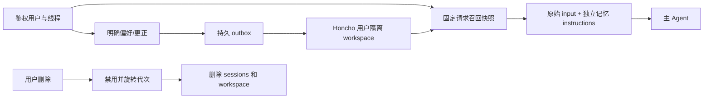
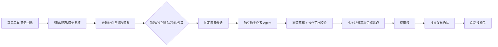

开发纪律与地址（开发前，2026-10-28）：服务器 `/home/h3c/project/python/scat-hermes-platform` 优先，仅使用已有 Anaconda scat-agent/scat-hermes/scat-rag-train，本机 base 传输、scat-frontend 静态检查；禁止 venv、uv 和新建宿主环境。临时文件仅两端项目 `.tmp/autonomy` 与原子同步暂存，结束清理；正式证据留 `var/validation/20261028-autonomy`。真实凭据仅服务器私有文件，正文、轨迹和密钥不进入公开报告。

服务地址：18140 Honcho、18141 本地 BGE-M3 Embedding、18142 有持久预算的模型代理；18144 自动作者原生 Hermes；18145/18146/18147 隔离平台/原生主 Agent/作者 API；18105–18107 沿用已有合成试跑。部署时复查端口归属，平台正式地址以最终验收记录为准。保留 RAG 18133、旧正式 API 18081、既有 GBAR/BentoML、Mongo27017及其他服务，不变更驱动或权重。

# 长期记忆与自动技能学习

本次范围：将 Honcho 接入平台主 Agent 的真实创建运行链路，增加用户可控的记录、召回、更正、删除；从可信工具/任务回执形成经验，达到用户配置阈值后调度独立作者 Agent 生成技能草稿并校验、隔离试跑。发布仍使用既有独立确认流程。

## 记忆链路

鉴权用户与线程 → HMAC 隔离 workspace/session → 固定请求的召回快照 → Hermes `instructions` → 原始 `input`。只有主 Agent 接收记忆，后台执行者和作者不接收个人记忆。召回内容标注为不可信数据，不能改变权限或授予操作授权。

采用用户明确陈述的偏好/记住请求，异步写入持久 outbox；不自动存储业务工具原文、模型结论、API Key 或真实轨迹。每次写入拥有稳定事件标识。发送结果不明保留 unknown，禁止盲目重复发送；重启恢复只处理未发送项。更正以新版本明确覆盖，删除先禁用和旋转身份，再删除旧 workspace，确认前显示 pending。

## 经验学习链路

服务端可信回执 → 去敏复盘（操作顺序、输入约束、失败分支、验收方法）→ 重复模式与独立输入阈值 → 固定来源摘要和 SHA → 独立作者原生 Agent → `learning_draft` → 校验 → 合成隔离试跑 → 待发布。候选内容只是参考数据；模型宣称成功、普通用户上传摘要均不能成为自动学习的可信成功计数。

学习开关、最少成功次数、最少独立输入、冷却期、每日草稿上限、上下文长度、模型调用上限由配置决定。默认保守启用，失败或结果不明暂停该候选；重启不重新运行已提交作者任务。没有自动发布，没有作者获取发布 Key 的路径。

## 验收要求

覆盖用户/线程/角色隔离、原问题不变、重试快照固定、异步写入、跨会话召回、更正/删除与重启恢复；覆盖真实回执来源、阈值、去重/冷却/日预算、作者权限和生成草稿可追溯性，以及实际原生作者和合成试跑。所有模型尝试（含失败）计入持久预算。测试不能以伪造 passed 报告替代既有可信试跑。

## 当前状态

2026-10-28 已实现记忆、可信经验采集、作者调度和部署封装。真实主 Agent 的跨线程召回、更正、重启，以及删除队列专项已通过；最终作者生成/试跑和运行版本以末尾验收记录为准。历史失败与旧镜像保留。

## 配置与用户控制

服务器私有配置：`var/deploy/autonomy/config.json`，公开样例 `config/autonomy.example.json`；不包含供应商 Key。修改学习参数后重启 `scat-auto-skill-learning.service`，修改记忆参数后在无在途任务时重建/重启平台容器。

| 配置 | 默认值 | 含义 |
| --- | --- | --- |
| memory.enabled | true | 平台主 Agent 的外部记忆；Hermes 内置文件记忆仍关闭 |
| memory.context_chars | 4000 | 本次注入记忆数据的字符上限 |
| memory.max_pending | 1000 | 普通偏好写入队列上限；满时不影响聊天 |
| memory.inactivity_days | 180 | 用户持续未使用记忆后，自动禁用并删除旧 workspace |
| learning.enabled | true | 可信来源采集与自动作者调度开关 |
| learning.min_successes | 3 | 同一操作流程至少成功次数 |
| learning.min_distinct_inputs | 2 | 参数摘要不同的独立输入数量 |
| learning.cooldown_hours | 24 | 同一流程再次生成草稿的冷却时间 |
| learning.max_drafts_per_day | 3 | 按北京时间统计，失败和不明结果也占用每日名额 |
| learning.auto_trials | true | 草稿通过校验后运行既有可信合成试跑 |

代理配置 `var/deploy/autonomy/proxy.json`：目前同时保留每日和整轮累计两组限制，均为 240 次请求、800 万保守单位。解除累计封顶被自动审批拒绝，需用户明确授权；因此不能把当前部署描述为已获准无限期按日运行。每次请求按 UTF-8 字节数加输出上限预留，另记供应商 token；不是费用报价。失败、连接中断、进程重启均不退回预留。用户批准转为持续日预算时，既有记录保留，不重置本日消费。代理固定 DeepSeek Flash、禁 thinking，原生单作者另受 12 次模型/20 次工具/75 万单位/240 秒限制，不自动升档。

记忆沿用平台 Bearer 鉴权，固定为当前用户，不接收 body/query 中的用户或 workspace：

- `GET /api/v1/hermes/memory`：开关、代次与写入队列状态。
- `GET /api/v1/hermes/memory/context`：当前可用记忆摘要，服务不可用明确标记。
- `PUT /api/v1/hermes/memory/settings`：`{"enabled":false}` 暂停并取消未发送项。
- `POST /api/v1/hermes/memory/corrections`：稳定 UUID `request_id` 与 `content`，重复提交幂等。
- `DELETE /api/v1/hermes/memory`：先禁用、撤销旧快照和旋转身份，返回 pending；后台先删除活动 sessions，再删除 workspace，并用 v3 admin list 的精确 ID 缺失确认完成。
- `GET /api/v1/hermes/memory/learning`：可信来源数量、阈值、生成任务/草稿/试跑状态，不返回业务原文。

删除针对可服务的长期记忆状态；既有原生聊天历史及数据库备份/WAL 不在此接口清理范围。旧请求的记忆快照撤销后拒绝重放，避免把更改后的上下文发给同一原生幂等键。

## 可信经验与失败处理

只读采集器同时核对平台线程归属、原生 completed 终态、未过期成功业务回执及 SHA、技能操作轨迹和参数 SHA；部分、失败、跨用户、回执篡改、无轨迹均跳过。后台任务只从 finished 且 job succeeded 的记录中重新验证保存/回读引用与后端摘要。复盘只保存操作顺序、约束与来源摘要，不复制参数值、轨迹、指标或用户对话。个人偏好不直接成为业务成功证据。

达到阈值后，持久账本先事务性分配来源与当日名额，再创建候选。自动作者只可处理该候选及其草稿，不可创建无关草稿、查看其他候选或自行发起试跑。新技能名必须 `auto-` 开头，单候选一项技能，允许操作必须是已验证经验的子集；既有校验器继续拒绝脚本和未注册操作。校验后调度器启动原有 S7-A 留出测试，每个相关场景 3 次，使用独立合成数据、角色/线程和临时目录，真实供应商模型，原始失败均留档。通过后进入 `ready_for_review`，需要原有独立发布确认才进入活动技能包。

重启将未完成调度标为 unknown，不重发原生 POST 或模型任务。维护者可先停止调度器，再用已有 Anaconda 执行 `scripts/manage_auto_skill_learning.py close-unknown --job <id>`；CLI 必须取得独占锁、核验自动作者端口关闭且原试跑不运行，才可收敛为 failed，重放次数为零。

已知失败且未生成草稿的维护者修复验收可用 `retry-failed --job <id>`：要求独占锁、核对端口及 `/proc` 原进程终止、原候选没有草稿，再创建新的任务/每日名额并保留原失败；同一父任务只能显式重试一次。自动调度不调用该入口。只读状态轮询允许重复 GET，运行 POST 不自动重发。原生作者的 state.db 和预算表以白名单归档在 `var/autonomy/author/<job>`，不复制临时 .env、缓存或 workspace。

## 部署与回滚

七个核心容器使用同一源码快照生成的三个增量 Conda 镜像，底层环境和制品沿用 H7-B 固定镜像，不重新安装包。仅平台容器挂载记忆身份/签名 Key 和记忆状态，以及只读学习账本。后台与作者不挂载个人记忆；作者 API 的合成试跑仅挂载独立 trial 代理令牌。

独立 Honcho API/deriver/Postgres 三容器采用 `unless-stopped`，使用 `var/deploy/honcho-production` 的持久数据库；CPU BGE-M3、限额代理和学习调度由项目目录中的 user-systemd 单元常驻。18144 作者进程仅按任务启动，用已有 scat-hermes Conda；该任务临时 profile 的 `.env` 只写代理令牌，结束清理。供应商 Key 仍在服务器既有 `var/deploy/honcho/secrets/honcho.env`，本轮无需申请新 Key。

操作入口：`scripts/deploy_autonomy.py prepare|build|activate`；构建完全离线，只复制已审核源码到固定旧 Conda 镜像，源码逐 SHA/归档，旧镜像及原 H7-B release 保留。activate 同时拒绝在途/unknown 任务、原生运行、试跑和学习任务。新核心入口仍为 `127.0.0.1:18120`，旧 `18081` RAG 原生入口保持既有用途。

回滚：先关闭学习开关并停止 `scat-auto-skill-learning.service`，核对所有执行终止，再运行原 `scripts/manage_container_deployment.py up --author --release 20261027-f983406a8700`。不删除记忆/学习/预算数据库；恢复新版本时不会重放 unknown。记忆单独停用可使用用户 settings；需要停整组依赖时用 `scripts/manage_honcho_test.py stop --production`，只操作自有服务。自动发布始终关闭。

## 验收记录

核心运行版本 `20261028-1276159c1aac`，七个核心容器均已切换新镜像并 healthy；独立记忆三容器运行，CPU Embedding、限额代理及经验调度三个 user-systemd 服务 active/enabled。核心 API 为服务器回环 `18120`；只读查询证实正式记忆和学习开关开启。前端未改动。

作者 API/手动原生作者沿用 `18124/18125`，自动作者 `18144` 仅任务期间启动。实际隔离记忆验证使用 `18145/18146`，`18147` 未启用；试跑 `18105–18107` 与这三个测试监听均已关闭。

真实合成验收：主 Agent 在新线程回忆中文/海里偏好、平台重启后仍可读、更正公里后新线程采用公里；来自 3 次原生合成查询、3 组不同参数的真实成功回执达到阈值。删除首轮失败如实保留，修复后独立真实持久 outbox 已发送、旧代次禁用、精确 workspace 确认缺失，跨 workspace 鉴权被拒绝；无模型重放。

独立原生作者实际生成 `auto-scat-flight-search`，草稿 `28854838e9de434d9ddb0a0c6b099dcf` 修订 1；8 次模型尝试、7 次工具调用、265953 原生预算单位。归档会话中 `learning_draft` 参数的内容 SHA 与实际数据库草稿一致，非维护者手写替代。真实工具轨迹也包含被权限层拒绝的目录列举尝试；之后成功读取候选、目录和已发布正文，保存并校验。

隔离试跑 `e2f991ea1f984ca79db1f27b47e3943a` 的 investigation 留出场景 3/3 通过，覆盖查询/质量/轨迹，临时环境和自有进程清理通过。草稿状态 `ready_for_review`；使用新镜像的新鲜试跑发布预览成功，不带独立发布 Key 的确认返回 403（测试请求 confirmed=false，不可能发布）。活动技能包仍为生成候选的原基线，尚未发布此草稿。

最终后端 **1373 passed / 1 skipped**，专项 76 passed，19 Python 文件 Ruff/格式通过；54 项最终部署/权限审计通过。已有三套 Anaconda history、固定 Hermes 源码、旧 GBAR 容器身份及原 18081/18133 服务保持。来源/生成/试跑使用合成数据，未将真实轨迹或个人记忆交给作者。

全轮限额代理共 45 次尝试：43 次完整完成、2 次流结果不明，保守预留 **2602708**；有明确 usage 回执的供应商 token 合计 **638716**，不明项不能视作零费用。全部计入现有累计和每日上限；当前未解除累计封顶，后续达到上限会暂停新增模型请求。

失败记录保留：Postgres 初启 socket 路径、隔离 profile 未初始化、错误作用域方法名、空 profile .env 优先级、冷启动轮询过短、Honcho 删除活动 session 顺序及不存在 GET 路由/删除竞态、验收脚本异步上下文。首个作者失败记录保留；修复后经受控 CLI 新建独立任务和每日名额完成原生作者与试跑，没有覆盖原失败。

自动审批拒绝了旧测试 workspace 清理及运行 profile AGENTS 修改的组合操作；运行 profile 未修改，现有运行上下文已明确外部记忆状态。遗留合成记忆 `scat-2a7ce3e64839505222e7be21216dc568e4a107ffe39094db42402cf23c56e04f-1` 已只读核验：仅一个会话、一个消息，与首轮失败验收的 scope 及完整合成输入 SHA 匹配；仍保留，等待明确删除授权。不依赖该清理即可使用两项功能。审批也拒绝移除累计费用封顶，未执行该变更。

服务器原始证据 `var/validation/20261028-autonomy`；公开元数据见 `docs/validation/20261028-autonomy-acceptance.json`、`20261028-native-author-proof.json`、`20261028-orphan-canary-ownership.json`。生成示例位于 `docs/examples/auto-scat-flight-search`，保留原始生成正文并附人工审核提示，不进入活动 skills 目录。

最后清理通过：两端本轮 `.tmp/autonomy` 已删除/确认不存在，服务器无测试监听或活动测试进程；正式日志、预算、身份映射与草稿/试跑证据保留。21 个宿主实现/配置/测试文件摘要一致，其中 20 个运行文件与新镜像源码清单一致；测试文件按设计不打入运行镜像。首个清理审计错误地要求镜像包含项目测试，失败依据留档后按正确边界重核。详见 `20261028-autonomy-cleanup.json`；旧合成 workspace 按审批要求保留，不混入当前用户新记忆空间。

