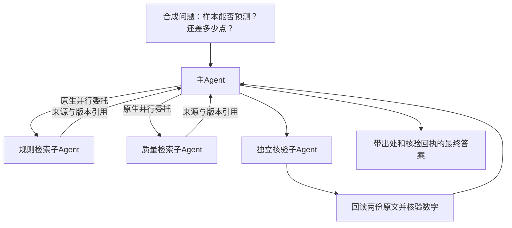

# Hermes 多Agent RAG技术试验与准入条件

开发纪律与地址（2026-10-25）：服务器项目 `/home/h3c/project/python/scat-hermes-platform`；只用已有Anaconda scat-hermes跑Hermes/DeepSeek、scat-agent做契约测试，本机scat-frontend检查/base传输。禁venv/uv/新环境/依赖安装。暂存仅两端项目 `.tmp/multi-rag`，正式合成回执/预算日志留服务器var/validation，结束清理。无新监听，原80/443/8080/8501/8091/27017及H6预留18130–18133保持；不启用生产GPU或替换8091。复用既有Key，外部模型仅接收本文件说明的固定合成资料，真实语料、冻结题及私有配置不进入工具结果。

## 为什么上一轮没有完成准入

上轮40题来自当前语料，且已经用于开发，只能作为开发诊断；95%到100%的证据组覆盖不能代表独立泛化。4B+Top100的p50/p95为4980.61/5280.64ms，已经超过既定75/200ms预算。两项分别是独立性与性能条件，增加Agent数量不会自动解决它们。

正式准入还需要：

1. 在编题前冻结新评测的类别、语言、难度、无答案/拒答/混合查询等配额。由未看到候选输出的新上下文编写，再由独立证据审核者验证资料版本、出处和完整证据包；不能复用已消耗题目或按其失败改题。样本量需能检出预设改善/回退，不能因为原诊断集有40题就认为40题足够。
2. 冻结语料/解析/分块、向量索引、模型版本、提示词、候选数及所有路由/预算；保留同输入基线。独立评测按预设次数运行，结果出来后不修改标签或门槛再重跑。
3. 验证原group R@5/R@10、候选覆盖、收益/回退数及类别下限，并测量完整检索服务的p50/p95/错误率。4B当前速度条件失败，先优化开发路线，再消耗新盲测额度。
4. 多Agent另评估答案引用支持、矛盾/无答案处理、跨会话隔离、实际工具权限、递归/共享预算，以及完整用户等待时间。相同检索器下比较单Agent与多Agent，才能区分编排收益和检索器变化。

如产品要支持耗时更长的“深度研究/异步任务”模式，可以通过明确的用户配置选择，但必须为该模式另定并验收用户可见的时延与成本目标；原快速检索门槛不能静默放宽。技术试验和模式设计均不自动赋予生产准入。

## 本轮实际试验设计

用固定Hermes原生 `delegate_task` 创建独立子Agent上下文；隔离进程仅适配同步结果返回、工具白名单和共享累计预算，不修改上游源码或生产角色配置。官方原生委托支持独立上下文与并行批次：[委托文档](https://hermes-agent.nousresearch.com/docs/user-guide/features/delegation)。实际兼容以项目固定源码为准。



固定合成资料：当前规则DEMO-POLICY@2要求有效点至少20、缺失率不超过2%；DEMO-QUALITY@1报告当前18点、缺失率5%。另有已停用旧规则，检索排除旧版本。两份当前资料通过scope/run、版本和内容SHA绑定；核验者必须亲自回读，不能仅用另一Agent的总结。事实篡改、跨运行引用、伪造回执均拒绝。

演示用两个有效文档的透明词项交集检索，无真实语料或4B模型参与；这验证多Agent编排和证据链，不测量原8091的召回质量。原BM25冻结实现保持不变，之前4B对比的源码身份仍有效。

首批两个子Agent应真实并行，第三个独立核验，合计4个真实会话；深度上限1、并行上限2、最多3个子Agent。主子累计最多20次模型请求、32次工具调用、100万保守token额度、300秒；token额度与供应商实际usage分别记录，不冒充费用。叶子只允许demo_search/demo_read/demo_verify；无终端、文件、网络、发布或业务执行工具。

隔离profile复用既有标准母版，在项目临时目录创建；子Agent使用原生独立会话及父会话关联，不创建常驻万能worker。正式profile不修改。临时profile及其中0600凭据结束后删除，正式无凭据回执保留。

## 复现入口与结果

服务器项目目录使用已有Conda：

```bash
/home/h3c/anaconda3/envs/scat-hermes/bin/python -B scripts/probe_multi_agent_rag.py --inspect-only
/home/h3c/anaconda3/envs/scat-hermes/bin/python -B scripts/probe_multi_agent_rag.py
```

inspect-only构造真实主Agent但不调用模型，检查工具表。正常模式会实际使用已有DeepSeek额度，运行合成链路并保存每次独立日志；失败材料保留，成功才更新固定结果摘要。

## 实际执行结果

最终 `df453576d6` 技术链路通过：4个独立原生会话，原生delegate_task先2任务后1任务，前两个研究会话运行区间真实重叠；每个子会话都有实际供应商模型请求，均绑定主会话，叶子工具严格三项。核验会话重新回读两份当前原文，实际demo_verify回执与最终结构化答案匹配。

用时28.39秒，成功轮14次LLM请求、共享工具准入计数14；provider input/output为65,241/5,302 token，保守额度另见原始账本，不据此计算费用。含三轮实际接入失败累计41次模型请求，其中失败尝试27次；更早预检均LLM0。初期异步入口未经过工具计数适配，其0计数不能解释为实际0工具执行，完整失败日志保留。

最终结构化结果：eligible=false、missing_points=2，证据为DEMO-POLICY@2和DEMO-QUALITY@1。中文结论为有效点18不足20，缺失率5%超过2%，目前不能执行预测；这只是合成资料推断，没有提交任何模型任务。

人工复核也发现原始自然语言将SYNTH-CV一处拼成SHYNTH-CV。原文不回写修饰；数值/引用/回执检查通过不等于所有实体表述已校验。该缺陷记录在验收中，后续正式评测需加实体标识一致性、无答案与矛盾证据等检查，不能宣称本轮已全面验证回答质量。

最终29项测试通过（演示/会话绑定11项、既有预算18项），Ruff/格式通过；原生profile及budget固定源码摘要未变，正式profile未修改。23个合成日志/源码文件扫描实际私有值0；本轮进程0，原六端口保持、H6预留关闭，项目.tmp/multi-rag已清理。临时profile使用原生SessionDB，成功/失败的无凭据回执保留在服务器var/validation。

主要接入修复：小样本词项检索、重复mkdir、关闭隔离profile自动tool_search装配、适配run_agent优先委托入口的同步交付、启动前源码SHA核对、按原生session_id而非跨线程ContextVar绑定证据工具、profile清理前停止日志队列。没有改生产工具白名单或上游源码。

证据：[四会话及实际合成回答](validation/20261025-Hermes-multi-rag.json)、[完整验收与失败额度统计](validation/20261025-Hermes-multi-rag-acceptance.json)。源代码：[演示入口](../scripts/probe_multi_agent_rag.py)、[固定合成证据工具](../src/hermes_runtime/multi_rag_demo.py)。
