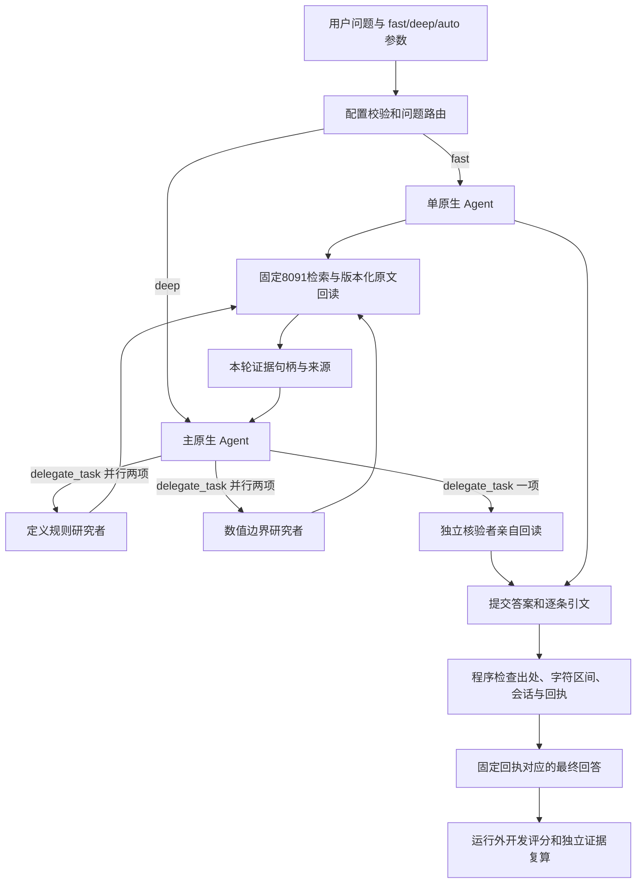

# 真实文档单 Agent / 多 Agent RAG（2026-10-26）

本页保留同8091检索的早期8题历史结果。后续0.6B完整40题、用户接受检索耗时、受控知识操作、重启与最终回归见[0.6B后端收口](HERMES_RAG_06B_COMPLETION.md)。

开发纪律与地址（开发前）：服务器项目 `/home/h3c/project/python/scat-hermes-platform`；Python 仅已有 Anaconda scat-hermes（原生 Agent）、scat-agent（测试），本机 scat-frontend 检查、base SSH；禁止 venv/uv、新环境及装包。暂存仅两端项目 `.tmp/real-rag`，结束核实后删除；正式私有运行、回答、账本留 `var/validation`。当前原 80/443/8080/8501/8091/27017 保持，18130–18133 关闭；本轮不新增监听。检索固定 `http://127.0.0.1:8091`；模型 `https://api.deepseek.com`，复用既有私有 profile Key，不输出或下载凭据。

用户授权：承接“开始进行”，开发真实语料 RAG、单 Agent 对照及受控多 Agent 问答验证。必要的当前文档片段发送既有 DeepSeek；参考答案及评分标签只在运行外评分，禁止注入 Agent 提示或工具。现有149块/8来源语料不修改，旧冻结题不读取。Ragas保持独立，运行时由固定 Hermes 原生 delegate_task 创建独立子会话。

## 范围和停止条件

先完成可复用证据存储、受控原生执行入口和开发验证。fast 为单 Agent；deep 为主 Agent + 两个并行研究子 Agent + 一个回读核验子 Agent；auto 依据公开配置中的问题长度/关键词路由，不读取标准答案。叶子不可委托，无终端、文件、网络及业务执行工具，仅检索、证据回读及审核提交。深度1、并行2，最多3个子 Agent；只用隔离临时 profile，不改正式角色或上游源码。

当前对照固定同一8091原BM25+BGE/RRF检索器、每次Top5，不把4B重排收益混入多Agent收益。4B尚无在线候选接口且快速时延不达标，本轮不切8091、不重跑GPU比较。deep的端到端时间单列，不冒充快速检索SLA。

首轮预选8道代表题，覆盖四类题型并包含上一轮004/018/030/038四道Top5改善题；全部只作开发诊断。每题fast/deep各一次，失败原样保留；同输入失败后不悄悄重跑。最多320次实际模型请求、8,000,000保守token准入单位、7200秒；单运行最多28模型请求/60工具/1,000,000保守单位/360秒，单响应最多2400token，无SDK自动重试。全局与单运行同时准入；usage另记，不称账单硬上限。开始真实调用前固定题号、配置和源码摘要。

## 证据和回答契约

读取固定语料SHA61788775e03c392b493a7835bba2e5d38d7f8721035b73ccbb1dda441eb53b86，逐块校验text SHA、唯一ID及source版本。检索响应必须与本地固定语料全文和身份相符；拒绝重定向和错误语料身份。模型只取得本次搜索产生的不可伪造引用句柄；句柄绑定scope/run/语料/分块/版本/摘要，未知或跨run句柄拒绝。核验者必须亲自回读引用，不能凭研究者总结提交。

最终结果包括answer、answerable/insufficient/conflict、逐条claims、原文短引文、字符区间、来源/位置和审核回执。程序验证原文、引用及回读历史，模型判断语义蕴含；逐字引文通过不等于事实推理正确。回执绑定完整答案，主Agent不得改写核验答案后复用旧回执。证据不足允许明确拒答；不得自动把检索无结果推断为全库不存在。实体、数值、单位与冲突处理另做开发评分。

## 验证与后续

专项覆盖语料篡改、伪造/跨运行引用、未回读提交、非核验角色、最终答案篡改、空证据及预算/路由边界。真实验证记录会话父子绑定、实际请求、并行区间、工具权限、原始答案、证据和失败。外部评审独立请求比较标准答案与实际答案，其评价与确定性证据校验分列；同供应商不称独立人工审核。

本轮通过后表示真实文档开发链路可用；全40题、无答案/冲突/注入专项、默认异步交付与进程中断恢复、独立holdout及正式部署仍各自验收。不因原生同步委托开发入口成功宣称所有生产路径完成。

## 首轮接入修复

v1首题出现多次length截断：原生响应实际包含较长reasoning_content，结构化答案又重复答案、claims和引文。004-fast最终形成回执，但回答过度展开，并将按问题对象选择的来源规则误写成全局排序，不能作为质量通过。通过持久共享预算将后续准入置为investigating_output_truncation；004-deep未完成，其他7组跳过，不称8组均实际执行。

首轮账本20次全局LLM准入，provider input/output=167075/25123，保守占用785573、工具11。首轮结果、失败与冻结源码留dev8-v1；v2另建目录，所有主/子客户端明确设置DeepSeek thinking disabled，约束短答案/必要引文，并强调来源规则按问题对象适用。v2剩余额度为300请求/7214427保守单位/989工具/7000秒，首轮与修复轮累计仍受原320请求/800万单位上限约束。SDK重试保持0。

## 开发入口

服务器项目目录执行，解释器必须是已有scat-hermes：

```bash
/home/h3c/anaconda3/envs/scat-hermes/bin/python -B scripts/run_real_agent_rag.py \
  --question 'Flight level（FL）的定义是什么？它是否等同于几何高度？' \
  --mode auto --output "$PWD/var/validation/my-rag-run"
```

输出目录不得已有，也不得位于项目var/validation之外。原始问答及结构化结果在该目录native-result.json/result.json；证据携带来源、版本、章节/定位、逐字引文和字符区间。该开发CLI每次单独隔离进程运行，不能作为同进程多用户服务反复调用，原生注册适配与环境变量仅限隔离进程。

仅检查工具、不调用模型时加`--inspect-only`。固定8组的入口为`--batch --output <全新批次目录>`；已完成批次拒绝覆盖，恢复只复用已持久化结果，started而无结果的运行保留unknown，不重放可能已计费请求。修改配置/源码后不能恢复旧批次。本轮v2是明确保留首轮失败后的修复验证，不是悄悄覆盖同输入失败。

独立来源/会话复算使用已有scat-agent运行`scripts/verify_real_agent_rag.py <已完成批次目录>`，不调用模型。正式业务主Agent当前仍使用已发布的知识技能；此入口先验收真实RAG子角色和同检索对照，知识技能到该执行器的正式操作注册、用户设置页和常驻异步服务接入另验收，默认业务包不修改。

## 运行链路



模型语义审核与确定性证据校验分开报告。真实调用包括模型自行纠正被拒绝的工具提交，以及原生内部续写/错误重试；SDK max_retries=0不等于整个Agent永不再次请求。所有准入仍经过单运行与全局账本，失败不退款冒充未调用。

## 已完成结果与实际边界

真实8题配对批次`20261026-real-rag-dev8-v2`完成。16次原生执行均通过，deep的8次均实际创建4独立会话、2路并行研究及1个原文核验会话；fast为1会话。共40个真实会话，全部18次后续独立复算（含v3回归）通过。

| 8题开发对照 | fast 单Agent | deep 多Agent |
| --- | ---: | ---: |
| 实际执行通过 | 8/8 | 8/8 |
| 同供应商新上下文模型初审通过 | 7/8 | 7/8 |
| Agent流程中位耗时 | 7.49秒 | 31.19秒 |
| 模型请求尝试（不含外部评分） | 36 | 130 |
| 引用命中固定证据组宏平均 | 0.750 | 0.625 |

耗时不含外层进程启动与清理，也不是线上并发SLA。固定标签未穷尽所有语义替代证据，引用组命中率不是回答准确率；逐字引文102处核对通过也不等于每个结论被引文蕴含。模型初审使用同供应商，不称人工独立质量验收。

018两种模式都遗漏标签定义、设备配置、飞行任务的混杂因素控制；离线诊断该必需证据组未进入搜索/回读，不修改题或标签来补分。004-deep虽被模型初审放行，助手发现它没有直接指出“对应UAV研究指南”，而扩展到无关边界，故不得仅凭7/8宣布质量通过。005/030-deep还有未经完整文档审计的全库否定表述风险，逐条语义审查继续保留。

v2复核发现最终正文可能超出已提交claims。已修复为`claims_only_v1`：公开答案只由已提交claims生成；没有claims的证据不足回答使用固定不夸大全库结论的措辞。原始模型参数与正文保留，不回写旧结果。v3`20261026-real-rag-render-v3`仅对005做明确记录的修复回归：fast/deep各一次均执行和模型初审通过，12处引用复算通过，最终正文恰与claims拼接一致。该回归不混入8题对照，不拿修复后的1题替换旧005成绩。程序仍不保证每条claim的语义正确。

服务器最终126项相关测试通过（检索59，加证据/委托/预算/复算67），6份Python源码Ruff和格式检查通过。原固定Hermes和正式profile、默认业务包均不修改；这里只新增隔离运行适配，不把原生默认异步派发或长期恢复宣称完成。

跨v1/v2/v3累计213次模型请求尝试（原生204、运行外评分9），其中9次APIConnectionError（v1四次、v2五次），原生内部恢复请求全部计入；v3无该异常。SDK自动重试关闭。已返回provider input/output为1,444,177/90,180，共1,534,357 token；cached为input子集不重复加。保守准入6,044,464、工具145，低于总320次/800万单位/1000工具上限。失败和缺usage保留，不作账单报价；最终连接异常的具体网络根因未证明。

**交付结论：真实文档RAG开发执行链路可用，本轮没有证明多Agent质量优于单Agent。** 保持fast/deep/auto可配置，正式业务默认入口保持原实现。后续优先改善子问题分工与缺口检查，分别对同检索器和受控4B深度检索做开发对照；再推进知识技能操作接入、全40题/拒答冲突注入、异步与中断恢复以及独立准入，不能直接切换生产。

机器证据：[运行与复核汇总](validation/20261026-real-agent-rag.json)、[环境与清理验收](validation/20261026-real-agent-rag-acceptance.json)。原生会话输出、评分响应、失败事件、冻结源码及SQLite账本仅留服务器`var/validation/20261026-real-rag-*`；本机只同步代码、文档和无完整原文的元数据。
