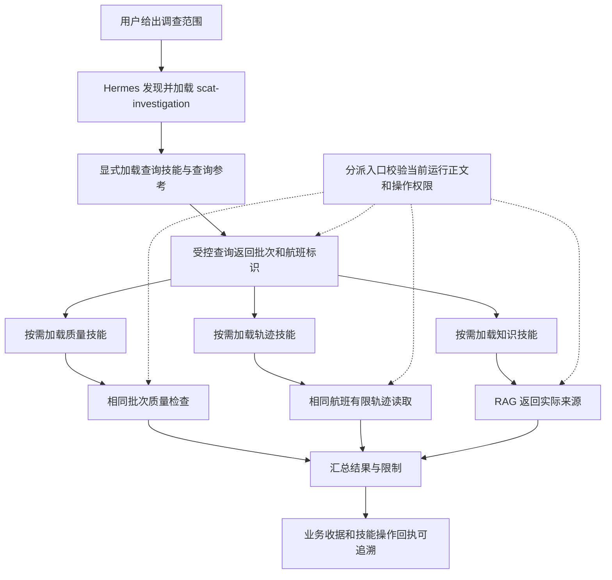

# S2 第二步：只读覆盖与多技能组合基础

> 日期：2026-10-23。开发纪律、已有 Anaconda 解释器和服务地址见 [主计划顶部](../SCAT_HERMES_PLATFORM_DEVELOPMENT_AND_TEST_PLAN.md#development-discipline)。开发测试优先在服务器 `/home/h3c/project/python/scat-hermes-platform`；禁止项目 venv/uv。临时文件仅使用项目 `.tmp/s2b`，收尾删除；正式证据保留在 `docs/validation`。

本轮继续 S 部分，完成 S2 的一个增量，尚未宣布完整 S2 完成。H6 展示在 S2–S6 业务主链稳定后实施。技能附属脚本暂不增加；开发/验收脚本属于项目工程工具，不是技能可调用终端或技能脚本权限。

> 后续状态：本文件保留 v2.4 第二步历史；v2.5 已完成 [S2 收口](HERMES_S2_COMPLETION.md)，配置、引用、模板和评测以该记录为准。

## 已实现的操作与技能

默认 H5 仍提供五个只读 MCP 工具和五个任务查询/准备工具。显式 `--with-skills` 才启用扩展的 26 个只读 MCP 工具；同时启用模型任务时，Hermes 精确可见集合为 26+5+2=33 个工具。模型准备尚无匹配发布技能，仍被技能操作准入拒绝；四类任务目录/历史读取保持自身授权。

| 技能（全部 0.2.0） | 允许操作数 | 实际范围 |
| --- | ---: | --- |
| scat-flight-query | 6 | 数据库/批次发现、航班检索、批次/单航班/机场概览 |
| scat-data-quality | 4 | 批次质量、问题/合格航班、模型输入质量检查 |
| scat-trajectory-analysis | 7 | 轨迹、飞行计划、已有预测概览/截面发现/读取、阶段与误差统计 |
| aviation-knowledge | 1 | RAG 检索与 source_id 引用 |
| uav-flight-analysis | 8 | 型号、航班、概览、通道、有限采样、通道/正常异常/阶段统计 |
| scat-investigation | 0 | 上层调查流程，精确依赖查询、质量、轨迹、知识四个子技能 |

发布清单 [skills.lock.json](../services/hermes/skills.lock.json) 升级 schema 2 / bundle `s2.1.0`，固定每个文件摘要、操作集、依赖版本和命名输入/输出契约。六个技能全部以 SKILL.md 规定流程，查询技能另有参考文档。清单契约是平台扩展，静态校验依赖存在、版本匹配、无循环和契约名合法；**尚无运行期类型化制品交接/自动参数传播或 DAG 执行器**。

上层技能不直接执行业务，也不继承子技能权限。每类操作仍须在当前可信 session/scope/run 实际加载对应正文；操作回执关联 load_id、版本、文件/包/参数/结果摘要。依赖声明不自动加载子技能。

扩展只读应用直接绑定中性 Service/Repository，不调用旧 LangGraph 主图。质量服务显式禁用持久 Redis 缓存，保留原数值实现；仅允许进程内缓存。UAV 采样默认 20、最大 100；已有预测截面发现最大 100，输出继续受 64 KiB 限制。查询质量不执行模型推理、清洗写入或 GPU 任务。

## 已实现的调用链



这是文档主导的模型编排，分支顺序由实际需求决定。当前没有页面上的技能关系编辑器、配置套用面板或步骤图。

## 验证与复跑

- 相邻回归最终 134 passed；完整后端最终 910 passed/1 skipped，28.00 秒。跳过项是未显式启用的 H5 隔离 Mongo 写入验收；沿用旧 H5 证据，一条既有 Starlette 弃用提示保留。
- 固定版原生分派：7 次非法调用不触发后端、2 次合法调用分别关联运行，实际 handler 重新注册后仍受约束；预处理和依赖安装调用均 0。
- 服务器实际业务独立探针：7 个读取操作通过，返回 SCAT 航班/轨迹点各 1、UAV 航班/采样各 1、UAV 型号 3；没有调用外部模型，原始数据不导出。不是全部 26 项真实数据逐项验收。
- 真实 DeepSeek+合成 MCP 最终通过，模型运行 18.07 秒；父技能、四个子技能正文及查询参考共 6 次受信读取，四条操作均关联当前正文。合成批次/航班/采样范围与返回证据校验通过。原始报告 [real-87551c70.json](validation/20261023-S2B-real-87551c70.json)。这是一条明确提示下的成功链，不能作为多次稳定性已通过的证据。
- 两个服务器 Conda 环境 `pip check` 通过。本轮未安装依赖。完整原始成功/失败记录见 `docs/validation/20261023-S2B-*`，最终汇总、清理与同步分别保存，不覆写历史报告。
- 收尾：服务器无本轮活动进程，18090 关闭，既有服务继续监听；两端本轮临时目录均已删除。服务器 405、本机 407 个文本文件扫描未发现配置中的实际私有值。最终源码/技能摘要、Conda 版本和清理证据见 [服务器审计](validation/20261023-S2B-server-cleanup.json)；完整测试汇总见 [completion](validation/20261023-S2B-completion.json)。

先检查解释器和端口，再在服务器使用既有环境运行（临时目录须先在项目内建立）：

```bash
conda activate scat-agent
PYTHONDONTWRITEBYTECODE=1 TMPDIR="$PWD/.tmp/s2b/tmp" python -B -m pytest tests -q -p no:cacheprovider --basetemp=.tmp/s2b/pytest
python -B scripts/probe_skill_business_readonly.py
python -B scripts/probe_hermes_composition.py
conda activate scat-hermes
python -B scripts/probe_skill_composition_native.py
```

组合探针临时绑定 `127.0.0.1:18090`，实际 DeepSeek 仅接触合成 MCP 数据，检查父/子技能正文、查询参考、四类操作、成功收据和同运行加载关联，以及合成范围/标识/返回证据一致性。探针结束停止子服务并删除独立 home。生产式手动运行应使用新的独立 home，例如 `--with-mcp --with-model-tasks --with-skills --home var/hermes/skills-s2b`，不复用不同配置的 home。

## 遗留与展示规划

1. S2 下一增量实现用户配置 schema/加载/有效配置查看和只读单次额度；当前 Skills 模式轮次固定 16，操作/加载/结果容量仍沿用固定上限，不能声称已经支持用户配置预算。
2. S2 补可复用调查参数样例、分业务题集和失败/缺参/空结果评测；本轮一条组合链不等于多轮稳定性、全部业务或完整场景验收。
3. S3–S5 将命名契约落实到真实类型化中间制品、模型步骤、后台恢复、对比与报告；S6 验证覆盖、容量与切换。
4. H6 展示“选择调查模板→配置范围和分支→查看技能关系/版本/参数→执行→逐步骤证据与结果→调整配置再套用”。需覆盖同模板不同合法批次、缺参/失败和结果复用边界；文档或模型声称套用不作为执行证据。详细阶段门槛见主计划 14.9。

失败记录保留：首轮相邻测试发现默认工具定义被复制后破坏已有超时夹具，已恢复默认引用、扩展模式独立字典；首个验收驱动因探针导入 lint 失败，未标成功；组合启动校验漏用扩展清单已修复；模型漏读必需参考的回合保留为失败。临时上传曾出现 Windows 分隔符名称，核实内容后仅删除本轮 14 个错误临时文件；CRLF 编辑锚点失败后按原摘要继续，没有覆盖未知远端修改。
