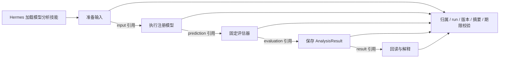

# S3：中性模型步骤与 CPU 数值对照

开发前先读[开发纪律与服务地址](../SCAT_HERMES_PLATFORM_DEVELOPMENT_AND_TEST_PLAN.md#development-discipline)：服务器项目 `/home/h3c/project/python/scat-hermes-platform`；业务 Python 仅已有 `scat-agent`，Hermes 仅已有 `scat-hermes`。禁止项目 venv/uv，临时目录为项目 `.tmp/s3`，探针仅 `http://127.0.0.1:18092`，结束关闭并清理。原服务、Nginx 与生产 GPU 不切换。以下记录为 2026-10-23 的 S3 范围。

## 交付与边界

从旧模型图提取 `src/scat_model_runtime/steps.py`，作为无 LangGraph、旧模型 Tool 或旧主 Agent 导入的数值内核。通用 adapter、回归 package、统一对比 package 三类路径均保留原计算实现，坐标、张量、单位和模型内部预/后处理继续在注册组件内部。`application/model_steps.py` 提供五个可独立调用的操作，不包含业务总流程图；顺序由 Hermes 加载的 `scat-model-analysis` 文档技能组织。

旧 `agents/model_agent/graph.py` 和旧模型 Tool 执行器保留独立数值对照与 H5 历史兼容。新任务目录/准备/查询的纯 record helper 转到 `application/model_records.py`；新步骤回用纯 AnalysisResult 渲染函数，不调用旧 Tool 或旧图。私有步骤子进程在返回前检查旧图/Tool/主 Agent 模块未加载，异常即拒绝。原图源码不改写成新步骤的包装器。

发布清单为 `s3.0.0`：保留原六技能版本，新增 `scat-model-analysis:0.1.0`，不增加附属脚本或自动依赖安装。默认 H5 仍为十工具。Skills profile 为 26 只读 MCP + 5 H5 控制/历史工具 + 2 技能读取 + 5 模型步骤，共 38 工具；普通业务步骤返回 `approved_job_required_s4`。只有启动器显式 `--s3-cpu-fixture` 且同时启用 Skills/合成 MCP，并将 home 放在项目 `.tmp/s3`，才可执行固定合成 CPU 样本。聊天参数不能改变模型、数据、归属、run、确认状态或环境。

本阶段没有把现网模型计算切换到新 worker，没有实现子 Agent 委托、批准 job、租约或后台恢复；这些是 S4 独立验收。生产 GBAR/V100 未运行。外部 DeepSeek 只接触合成信息；真实业务库查询为零。

## 冻结操作契约

机器契约见 [model-operations.v1.json](../services/hermes/model-operations.v1.json)，原生桥接启动时逐项核对工具 schema。版本均为 `1.0.0`，环境别名 `scat-agent`；APP 子进程监督超时 20 秒、原生分派 25 秒，模型包沿用 ModelSpec 的内部超时。S3 的固定 CPU 模型内部为 5 秒。超时不表示后台效果已停止，无法确认的计算进入 unknown，不能自动重跑。

| 操作 | 输入 | 输出 | 效果 |
| --- | --- | --- | --- |
| `scat_model_prepare_input` | 可信控制器固定任务，无聊天参数 | input 引用 | 输入读取及派生写入 |
| `scat_model_run` | input 引用 | prediction 引用 | 注册模型计算 |
| `scat_model_evaluate` | prediction 引用 | evaluation 引用 | 固定评估器计算；统一对比包复用内部评估 |
| `scat_model_save_result` | evaluation 引用 | result 引用 | 保存标准 AnalysisResult |
| `scat_model_read_result` | result 引用 | AnalysisResult 与引用 | 当前可信运行读取 |

确认/取消/核实属于独立控制面，不是技能计算权限。普通业务的批准快照尚由 S4 对接，工具没有 confirm/submit/shell/任意数据库查询参数。S3 CPU 任务由启动器固定 `synthetic-cpu-cv:1.0.0`、`synthetic-cpu-input:1.0.0`、`regression-errors:1` 和空参数；显式请求版本，拒绝模型登记摘要或组件源码摘要变化。



## 中间制品与幂等

`model-step-reference/v1` 含随机 artifact_id、阶段 kind 和内容 SHA256；`model-step-artifact/v1` 保存精确请求/模型/组件摘要、上游引用和服务端完整类型状态。输入 schema、单位、特征顺序、张量 dtype/shape、UTC 起点、相对秒、source indices、预测和评估版本都由相应 Pydantic 协议及闭合 JSON codec 保留。制品不使用 pickle 或按任意类名加载代码；不支持的对象、非有限值、对象数组和非法 tag 拒绝。

SQLite 在事务中同时提交制品和成功回执；按 scope/run/operation/规范参数摘要识别同一逻辑步骤。成功重复调用返回原引用，进程重启后可复用；running/unknown/failed 不直接重新执行。计算已完成但保存失败时保留 unknown，不能靠换 tool_call_id 重跑。S3 固定样本只允许每 run 一次逻辑实验；有意重复实验的 seed/序号、全局 job 幂等和 lease fencing 由 S4 加入。

读取每次核对当前可信授权、归属、run、类型、期限、正文摘要、请求/登记/组件摘要。跨 run 引用直接拒绝，不当作子 Agent 委托授权。单制品上限 16 MiB，支持至多一百万数值数组元素；原始张量留在服务端，只返回引用。合成配置统一 600 秒固定期限，不因后续 subprocess 调用而续期。大规模存储、自动归档和生产保留策略按 S4/S6，不以小样本验收代替。

主要错误包括 `approved_job_required_s4`、`step_grant_expired`、`model_registration_changed`、`component_implementation_changed`、`step_artifact_*`、`model_output_*`、`step_unknown`；完整清单和效果/证据字段见机器契约。内部异常只返回固定拒绝码及异常类型，不把路径、后端异常正文或配置传给模型。

## 数值样本与验收

黄金样本是四个独立于业务库的 ENU 观测，单位均为 m，UTC 起点 `2026-01-01T00:00:00Z`，采样间隔 1 秒。输入 `(x,y,alt)` 为 `(0,0,1000)`、`(10,20,1005)`、`(20,40,1010)`、`(30,60,1015)`。CPU 匀速组件根据最后两点实际算速度，在相对 1/2 秒预测 `(40,80,1020)`、`(50,100,1025)`；合成真值为 `(42,80,1020)`、`(50,99,1025)`。标准评估器计算 MAE `1/0.5/0 m`、RMSE `sqrt(2)/sqrt(0.5)/0 m`；这是 ENU 轴向误差，不生成经纬度 ADE/FDE。

测试将冻结旧图和新内核独立运行同样组件，比较输入、预测、评估、单位、时间轴和标准结果，数值容差绝对 `1e-12`、相对 0。三类已有组件夹具还验证持久化步骤交接及结果一致；不把 CPU 通过推广为生产 GPU 精度验收。拒绝用例覆盖错归属/运行、类型、正文与版本篡改、过期、组件/登记改变、额外授权参数、单位/时间/模型身份漂移、成功重复和计算后丢失提交。

服务器有限驱动 [driver](validation/20261023-S3-a0fada66f0-driver.json) 通过：完整后端 [984 passed / 1 skipped](validation/20261023-S3-a0fada66f0-full.log)，36.88 秒；跳过既有 H5 显式启用的隔离 Mongo 写入测试，保留历史证据，既有 Starlette 提示一条。两套 Conda pip check 通过，无依赖安装。Ruff check/format 通过。本机最终相邻 [77 passed](validation/20261023-S3-local-final.log)，16.38 秒。

[真实 Hermes + DeepSeek + 合成 CPU](validation/20261023-S3-hermes-1fc35736cd.json) 通过：实际模型运行 75.44 秒，7 次工具调用（列表、正文和五步骤），11 次受计量 LLM 请求，5 条业务操作/正文关联、4 条成功持久步骤。模型输出、误差、单位、时间轴、最终引用与标准结果逐项通过。三次供应商临时连接恢复计入同一预算；保守额度 675795，供应商 input/output 128770/956，均在既有配置内。这是单次成功，不代替 S6 多次稳定性验收。原始运行日志保留。

本机首次沙箱 pytest 无输出挂起，仅停止匹配本轮命令的进程并允许本机回环；随后首轮 70 passed/3 failed，因旧数值测试夹具导入无关 UI 注册表而需要本机未安装的 Redis。测试仅去掉该无关导入，保持旧图和数值夹具原样计算，不安装依赖，随后 73 passed；补充持久化三类路径及组件冻结后最终 77 passed。失败 [原始日志](validation/20261023-S3-local-initial-failed.log) 保留。网络多次 SSH 超时后恢复，代码安全同步完成才在服务器启动有限驱动。

复跑（仅服务器已有 Anaconda）：

```bash
cd /home/h3c/project/python/scat-hermes-platform
/home/h3c/anaconda3/envs/scat-agent/bin/python -B scripts/validate_model_steps_s3.py
# 包含一次真实付费 DeepSeek，但数据和 CPU 样本全部合成：
/home/h3c/anaconda3/envs/scat-agent/bin/python -B scripts/validate_model_steps_s3.py --include-real-llm
```

驱动有限运行，逐阶段保存唯一 `docs/validation/20261023-S3-*` 日志，失败即停止且保留失败报告；正式证据不覆盖。临时目录结束后按项目边界核实并清理。真实模型报告检查五项实际操作、同运行正文加载关联、四条持久步骤成功回执、真实 CPU 数值、最终引用、标准结果和实际预算。

## S4 故障注入与接入接口

| S3 已有边界 | S4 要补的持久接口及验证 |
| --- | --- |
| ModelStepGrant 固定请求/模型/组件摘要，聊天无授权字段 | 从已确认 job 读取批准快照；校验范围、技能/操作版本、共享预算和租约代次，禁止旧 worker 新发效果 |
| 五操作 + 阶段引用 | 后台独立 Hermes session 选择步骤，主对话不断开；跨 run 交接须显式委托 grant |
| reserve/save/fail 与 succeeded/running/failed/unknown | 增加 prepared 与 lease/job/逻辑 step identity；计算前退出、计算中断联、提交丢失、回执未反馈、重复领取逐项注入 |
| 成功步骤重启复用、未知拒绝重跑 | 外部执行号/幂等键与后端核实接口；unknown 核实完成前保持资源隔离 |
| AnalysisResult 与只返回引用 | 接正式 run/artifact 仓库与归属 HTTP 读取；API/worker 重启、聊天关闭及 SSE 断开后结果仍可查 |
| S2 单 run 额度作用于本轮 CPU 探针 | 批准 job 累计预算、主子共享额度、修订后续准入、达限后恢复；不得给每个子 run 重置完整额度 |

S4 先实现并验收一份样本、一个 CPU 模型、一次评估、一份结果，再扩多模型/批量/GPU；H6 再做场景中的主子任务、技能关系和复用/重算展示。

## 本轮收尾状态

功能源码、技能包和服务器验收已完成；原始证据已取回。之后网络再次中断，连续 SSH 超时，系统 ping 2/2 超时。本机临时目录已清理；最后完整文档/错误码元数据回传、远端三项契约复验和整轮临时目录/端口审计待网络恢复，不能声称全部同步或服务器收尾完成。预期摘要、已通过部分和待办见 [S3 同步清单](validation/20261023-S3-sync.json)。普通业务计算继续要求 S4 批准 job。

2026-10-23 S4 开始前已恢复连接并补齐上述 S3 收尾：39 文件同步、服务器契约三项复验、临时目录清理/端口/私有值审计通过；原 pending 清单保留，[解决记录](validation/20261023-S3-sync-resolution.json) 和[服务器清理](validation/20261023-S3-server-cleanup.json)记录实际结果。后续批准后台链路见 [S4 专项](HERMES_S4_BACKGROUND_JOBS.md)。本页上文保持 S3 当时阶段范围。
