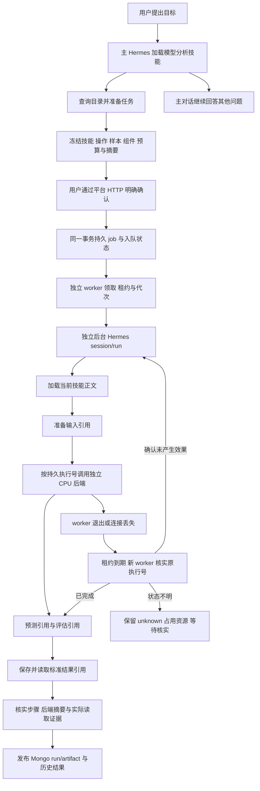

# S4：批准任务、后台 Hermes 与恢复

开发前先读[开发纪律与服务地址](../SCAT_HERMES_PLATFORM_DEVELOPMENT_AND_TEST_PLAN.md#development-discipline)。服务器项目 `/home/h3c/project/python/scat-hermes-platform`；业务/测试只用已有 `/home/h3c/anaconda3/envs/scat-agent/bin/python`，Hermes 只用已有 `/home/h3c/anaconda3/envs/scat-hermes/bin/python`。禁止项目 venv/uv，本轮临时目录仅两端项目 `.tmp/s4`；验证端口 `127.0.0.1:18093`（平台）、`:18094`（主对话）、`:18095`（后台），结束关闭。不改 Nginx/既有服务，不启生产 GPU，外部模型只接触合成数据。

## 实现范围

发布包 `s4.0.0`，模型分析技能 `scat-model-analysis:0.2.0`，保留另外六个技能版本。技能仍用 SKILL.md 规定流程，没有新增技能附属脚本；工程中的 worker、执行器和测试脚本负责执行边界及验证。Hermes 根据技能选择业务步骤，Python 负责授权、状态和证据核实，没有用旧模型图调度新任务。

首条链路固定一份 `SYNTH-CPU-001` 合成样本、一个 CPU 匀速预测、一次误差评估和标准 AnalysisResult。输入为四个 ENU 米制观测，模型 `synthetic-cpu-cv:1.0.0`，评估器 `regression-errors:1`，参数为空。S4 未开放任意真实业务模型、批量/对比、物化或 GPU；这些由 S5 扩展。S6 稳定性、归档和 H6 展示页面继续独立验收。

主对话 Skills profile 保持 38 个工具；普通业务五步骤没有批准能力时拒绝。后台角色只有 7 个工具：技能列表、正文读取和五个模型步骤，没有 MCP、准备/确认任务、终端或数据库自由查询工具。默认 H5 十工具兼容 profile 保留；平台 API 默认 `HERMES_SKILL_JOBS_ENABLED=false` 保留原入口，新 Skills 部署须明确设为 true，并与原生 `--with-skills` 配套；本轮探针显式启用，未提前进行 S6 主入口切换。新 worker 默认使用 S4，旧图 worker 仅 `--legacy-h5` 显式启用，且不能领取 Skills 快照任务。

## 委托与调用链



确认重放只生成一个 job。任务预算、技能/发布包/操作目录、实现源码、模型与组件版本、样本内容摘要、资源/深度及 24 小时有效期写入批准快照。普通聊天字段不能修改确认、run、归属、租约或环境；快照变化必须重新准备和确认。

委托绑定原 job、子 scope、实际 native run/session、允许操作子集、父委托、深度和期限。能力只由可信会话绑定器注入私有桥接，不进入工具参数 schema。嵌套委托只能缩小操作集合，祖先撤销使后代失效；恢复代次变化使旧会话失效。新子会话通过授权读取原 job 的阶段引用，普通跨线程/跨 run 引用仍拒绝。

Hermes 环境只加载轻量 SQLite 授权/预算模块；模型、NumPy 和实际数值步骤留在业务 Conda 子进程。启动时核对批准文件/发布包，业务桥接在每个步骤前再次核对输入和数值组件。不能通过向 Hermes 环境补装全部业务依赖掩盖环境边界。

## 状态、幂等与停止

同一 SQLite 保存任务、job、委托、会话、预算修订、步骤回执、后端执行回执和事件。逻辑步骤身份取自 job/操作/规范化输入引用，成功重复调用返回同一引用，不依赖 LLM tool_call_id。后端执行号固定绑定 job 的一次 CPU 计算，先持久化 prepared 再启动进程；子进程在事务中检查租约、代次、输入和预算后进入 running，记录 PID、Linux 进程出生标识及 calls。

| 观察状态 | 处理 |
| --- | --- |
| 未确认 | 没有 job，不启动任何模型效果 |
| queued | 等待原主会话预算导入及资源准入 |
| running | 当前 worker 有有效租约；新步骤和预算准入都检查代次 |
| unknown | 不能据文字/超时判断是否执行；核查持久后端号，保持资源占用 |
| 后端 succeeded | 验证输入和输出摘要；复用原输出，不启动第二次计算 |
| 没有后端号或仍 prepared | 本实现保证计算前先写后端 running，核实后可继续未产生效果步骤 |
| paused | 预算或恢复次数达限，保留中间引用；获明确授权并核实后恢复 |
| cancel_requested | 已撤销新效果能力；等待实际后端停止或终态证明 |
| cancelled/failed/succeeded | job 终态；成功须实际步骤和标准结果核实，不能依据 LLM 成功文本 |

worker 默认租约 60 秒、心跳不大于租约三分之一；故障探针使用 6 秒。所有效果入口和写入回执的事务检查当前代次。租约失效不能让旧 worker 再发新效果，但已准入的独立 CPU 计算可以完成并保存外部证据。取消仅向核对 PID 出生标识的本任务进程发停止请求，不凭 PID 杀其他任务。聊天停止、取消请求和实际后端停止分别记录。

CPU 模型执行超时为 30 秒，业务桥接监督 45 秒、原生分派 50 秒；S3 独立夹具内部 5 秒保持原值。超时没有改变 unknown 规则。Mongo 发布使用确定的 artifact ID 和归属/摘要核验；发布回执丢失时恢复发布，不重新计算。暂停 job 的标准 run 可能仍显示 running，应同时查看返回的 skill_job.state；H6 后续统一展示。

## 用户配置与共享预算

策略见 [skills-policy.yaml](../config/skills-policy.yaml) 及对应 JSON Schema。

| 项目 | 默认 | 明确修订的部署上限 |
| --- | --- | --- |
| LLM 请求次数 `max_turns` | 24 | 48 |
| 保守 token 准入单位 `max_llm_tokens` | 1000000 | 2000000 |
| 工具尝试次数 `max_tool_calls` | 80 | 160 |
| 累计墙钟秒 `wall_seconds` | 1800 | 3600 |
| 同时占用 job 资源 | 1 | 当前部署以单队列/单后台端口验收 |
| 委托组合深度 | 6 | 批准快照及部署策略约束 |

请求/用户偏好只能降低当前默认额度，不能暗中提额；批准快照冻结实际额度和上限。一个 job 所有子 run 及恢复后的新 session 使用同一持久账本。原任务准备主会话完成后，将其实际计数/保守预留导入一次；主会话未完成或未被墙钟约束隔离时不领取。另一个与任务无关的独立聊天有自己的额度。恢复不会重置计数或累计开始时间，子会话结束也不会结束整个 job 账本。墙钟保守取任务账户建立与主规划开始的较早时间，包含批准后排队时间；不会通过长时间排队获得额外执行额度。

预算耗尽后停止新调用和新效果，跟踪已开始的后端结果。暂停任务可由同归属用户调用 budget 接口，必须提供原批准摘要和 `confirmed=true`；仅显式给出的额度字段改变，不能超过批准/当前部署上限较小值。修订写新 revision，代次递增，累计次数与时间保留，旧会话不能准入或污染新修订。货币上限仍不支持，`max_cost` 必须为 null；保守准入单位不是供应商计费 token。

资源状态 unknown 时不释放槽位，避免另一个任务与未核实计算重叠。CPU-only 阶段未测多 worker 并发吞吐；调大配置不等于完成多端口调度或 GPU 并发验收。自动归档/缓存仍按 S6，不据 schema 字段宣称已实现。

## 控制 API 与复跑

所有路径前缀为 `/api/v1/hermes/threads/{thread_id}/model-tasks`，沿用平台认证与归属隔离。

| 方法/路径 | 请求与用途 |
| --- | --- |
| `POST /`（无尾部子路径） | 方案与可选收紧预算；不执行模型 |
| `POST /{task_id}/confirm` | `snapshot_sha256` 与 `confirmed=true`；幂等批准入队 |
| `GET /{task_id}` | run、job、步骤、后端、共享预算及最终引用 |
| `POST /{task_id}/cancel` | 空对象；撤销新效果并请求核实停止 |
| `POST /{task_id}/reconcile` | 空对象；核实回执或恢复发布；状态不明不重新计算 |
| `POST /{task_id}/budget` | 原摘要、明确确认和 `limits`；暂停任务预算修订 |
| `GET /{task_id}/artifacts/{artifact_id}` | 归属内标准 AnalysisResult |

上述控制操作不是后台业务工具。CLI `--reconcile TASK_ID --thread THREAD_ID` 只核实本地执行状态；完整 run/artifact 发布由 worker 或平台接口完成。

在服务器项目内明确使用已有 Conda：

```bash
/home/h3c/anaconda3/envs/scat-agent/bin/python -B scripts/validate_skill_jobs_s4.py
/home/h3c/anaconda3/envs/scat-agent/bin/python -B scripts/probe_skill_jobs_s4_faults.py
```

真实合成模型探针会产生外部模型请求费用，并临时启动上述三个空闲回环端口：

```bash
/home/h3c/anaconda3/envs/scat-agent/bin/python -B scripts/probe_skill_jobs_s4.py
```

常驻 worker 用 `scripts/run_model_worker.py --job-home var/hermes/jobs --background-port 18095`；生产计算仍未开放。隔离合成演示需显式 `HERMES_SKILL_JOBS_ENABLED=true`、`SCAT_S4_CPU_FIXTURE=1`；主 Hermes 使用 `--with-skills --with-model-tasks --with-mcp --synthetic-mcp --s4-cpu-fixture`。探针自动设置独立状态文件、唯一 Mongo 集合和临时 home，不可直接复用为生产配置。`SCAT_S4_CPU_DELAY_SECONDS` 只供维护者故障注入，不能由工具参数传入。

## 验收证据

确定性进程故障矩阵已通过，见 [最终故障报告](validation/20261023-S4-faults-62911dce56.json)：效果前退出、计算中进程丢失、成功后丢提交、提交后丢回复、实际取消停止、预算修订恢复、后端摘要篡改拒绝；计算次数均按场景核对，恢复没有产生第二次模型计算。单元/HTTP 用例另覆盖未确认、重复批准/领取、失效租约、成功步骤复用、跨归属/引用隔离、委托缩权与撤销、累计预算、发布证据和旧 worker 隔离。

首次故障轮次暴露 Conda 冷启动超过 S3 的 5 秒，独立测得启动约 6.18 秒而实际计算约 0.002 秒；仅 S4 使用上述超时。第二轮暴露已完成但无 pending 步骤时遗漏后端摘要核查，已改为核查所有成功后端回执并补回归。失败报告保留。首次真实委托暴露 Hermes 精简环境误导入业务 NumPy，已拆分轻量启动授权并增加精简环境导入验收。

最终[完整驱动](validation/20261023-S4-0a30282534-driver.json)通过：后端 1005 passed/1 skipped，Ruff/格式、精简 Hermes Conda 导入及两环境 pip check 通过；本机新增[21 项测试](validation/20261023-S4-local-final.log)通过。跳过沿用 H5 显式隔离 Mongo 测试，既有 Starlette 提示保留，未安装新依赖。

[真实主子 Hermes/DeepSeek 验收](validation/20261023-S4-hermes-5081b0331b.json)通过：205.51 秒；人工确认重放仅一个 job，SSE 断开重连，主对话继续回答，关闭平台/主 Hermes、SIGKILL worker 进程组、等待实际租约到期并启动新 worker，最后重启 API 仍可读任务和标准结果。两个实际后台会话代次为 1/3；CPU 一条执行回执、calls=1；6 条合法正文关联包含 1 条真实 admitted 中断和恢复后的五步骤返回。累计 14 次 LLM/14 次工具尝试，保守准入 523427，供应商 input/output 134640/2097，缓存 110208 单列；跨线程读取拒绝。

连续 DNS Temporary failure in name resolution 导致第 4–6 轮在准备前失败，均无 job/计算。最终一轮仅在该探针及后代进程中、最多 600 秒复用服务器原生 getaddrinfo 已解析地址；保持原主机名、真实供应商与 TLS 校验，未改系统 DNS、项目私有配置或注册模型。临时解析文件随本轮清理，方法记录见 [DNS 验证条件](validation/20261023-S4-dns-method.json)。这些失败全部保留；通过一轮不代表 S6 多轮稳定性。

另验 [SIGTERM 清理](validation/20261023-S4-signal-cleanup.json)：在对话前终止探针，独占进程、唯一 Mongo 集合及私有 home 正常清理，无 job/计算。有限驱动超时先发 SIGTERM 给探针并等待清理，再按需要结束监督进程；端口占用检查在创建临时 home 前完成。最终[服务器审计](validation/20261023-S4-server-cleanup.json)、[本机审计](validation/20261023-S4-local-audit.json)与[同步清单](validation/20261023-S4-sync.json)分别记录收尾。主计划 S4 按本阶段门槛完成，下一步 S5。

## 后续工作估计

S4 CPU 恢复基础已将状态与数值执行分离，后续估计按人日、单人有效开发时间计：S5 中性批量/对比/物化迁移约 5–8 日，GPU 适配另按驱动/权重/显存和部署实测；S6 多轮稳定性、容量和归档约 3–5 日；H6 技能套用/配置、主子任务关系和七类图形约 5–8 日；H7/H8 部署与整体验收约 3–5 日。S7 正式创作发布按既定 A/B 范围另估 4–7/7–12 日。区间为工程估计，不能由一次 CPU 成功推断 GPU 工期或稳定性。
