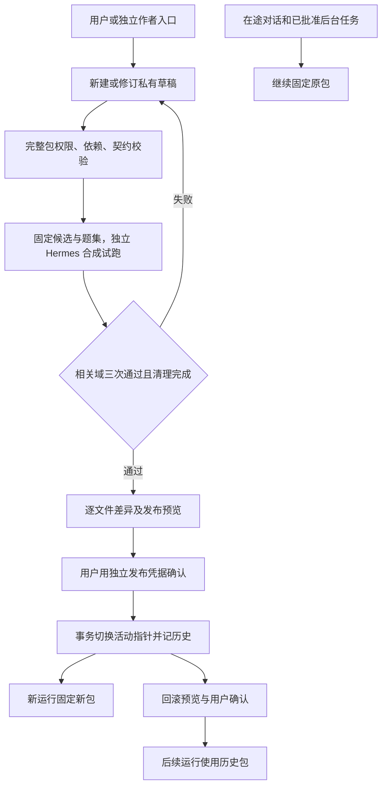

# S7-A 技能创作后端

2026-10-27新增经验候选接口准备：来源快照提交/读取/去重与事务内幂等生成草稿，作者工具增加learning_list/read/draft，复用本页校验/试跑/发布。自动记忆采集与调度尚未接入，固定运行镜像尚未更新。详细契约见[技能经验接口](HERMES_SKILL_LEARNING_INTERFACES.md)。

开发纪律与地址：2026-10-24；仅已有 Anaconda scat-agent/scat-hermes，禁止项目 venv/uv。服务器项目 `/home/h3c/project/python/scat-hermes-platform`，临时目录两端 `.tmp/s7a`，结束清理。作者 API `127.0.0.1:18104`、隔离 Hermes `:18105`、平台 `:18106`、后台探针 `:18107`，启动前复查空闲；现网不变。前端暂停，GPU 关闭，外部模型只用合成数据。

## 实施范围与验收

1. 草稿独立存储，支持新建、修订、历史、读取和差异；乐观并发控制，保留每次内容摘要与基线版本。草稿更新既有技能时须维护依赖版本和契约兼容，不静默修改其他技能。
2. 校验名称、文档章节、前置依赖、已注册操作、契约、循环、资源和组合深度；文档不执行脚本、不自动安装依赖。试跑使用固定候选快照、独立 profile、合成样本及有限预算；保留失败和耗用，不接受客户端自报通过。
3. 内容寻址完整技能包；发布预览固定基线、候选摘要、逐文件差异及试跑证据，有期限并须人类确认。事务切换活动指针；重复确认幂等，过期/变化拒绝。回滚也须预览确认；新运行读取活动指针，在途运行、已确认任务及后台执行读取原包。
4. 验收包含作者身份隔离、跨草稿访问、并发修改、失效预览、包篡改、崩溃/事务恢复、旧任务固定、回滚、真实固定 Hermes 合成试跑及完整后端回归；每次失败保留并记录修复。

作者 API 独立启动，默认不挂业务入口；业务 Agent 只有原业务工具组，无创作/确认/发布权限。S7-B 脚本沙箱与 H6 前端另行开发。本轮四步已完成；候选仅在独立验收 catalog 发布/回滚，默认业务包未变。

## 实施中的失败与修复

- 首轮服务器专项 82 passed/1 failed：相同内容连续保存的内容摘要不变，无法阻止旧预期摘要再次提交。已将修订号纳入摘要；复测 83 passed。
- 原生固定版本无模型并发探针通过：24 次目录/操作准入交错读取，新旧及回滚后的包隔离，上游根目录不变。
- 首次真实作者链试跑三次均成功（查询/质量/轨迹各3/3），但沿用了 S6“必须覆盖十一域”的汇总器，整体错误标 failed，发布门槛正确拒绝。原始失败保留为 `20261024-S7A-trial-78b9ec57ed.json`、`20261024-S7A-lifecycle-1502efceb5.json`。修复为作者试跑预先固定所需域，逐域最少三次；S6 默认仍要求十一域。不回填原失败，重新完整试跑。
- 自动审批拒绝一次未逐项限定的远程汇总/日志回读；改为固定文件的状态枚举、数值和布尔值，无需扩大业务数据导出范围。
- 首轮完整后端 1088 passed/1 failed/1 skipped：伪造技能包摘要仍被拒绝，但新解析器向应用层抛出了 SkillPolicyError，破坏既有 TaskConflict 契约。已在模型、工作流与后台准入边界统一转换为原异常，不降低拒绝条件。

## 配置和 API

作者服务由现有 `scat-agent` 执行 `scripts/run_skill_author_api.py --port 18104`，仅绑定回环地址，不自动常驻。启动前由维护者准备项目内两个不同的私有凭据文件（Linux 0600，至少32字符），分别以 `SCAT_AUTHOR_KEY_FILE`、`SCAT_AUTHOR_RELEASE_KEY_FILE` 指定项目相对路径。作者请求使用 `X-SCAT-Author-Key`；最终确认额外要求 `X-SCAT-Release-Key`。不复用业务 AUTH_SECRET；业务 API 和工具列表不增加作者路由。发布凭据留人类确认入口，不交给业务或作者模型。

`SCAT_SKILL_RELEASE_STATE` 指定项目相对 SQLite 路径，默认 `var/skills/catalog.sqlite`。平台、主 Hermes、作者及后台进程须继承同一值。验收使用独立临时 catalog，不修改默认活动包。未初始化时兼容读取原 `services/hermes/skills.lock.json`；首次显式启动初始化原包，无新候选自动发布。

| 方法/路径 | 作用 |
| --- | --- |
| `POST /v1/skills/drafts` | 新建，传 `content`，可指定已注册的基线摘要 `base` |
| `GET /v1/skills/drafts` | 当前作者的草稿列表 |
| `GET /v1/skills/drafts/{id}?revision=N` | 当前/历史修订 |
| `PUT /v1/skills/drafts/{id}` | 修订；必须传当前 `expected_sha256`，可显式换基线后重新试跑 |
| `GET /v1/skills/drafts/{id}/history`、`/diff` | 修订历史、完整包逐文件和权限/契约差异 |
| `POST /v1/skills/drafts/{id}/validate` | 完整包静态校验，返回候选摘要 |
| `POST /v1/skills/drafts/{id}/trials` | 固定当前修订，202异步启动受控试跑；同时至多一个 |
| `GET /v1/skills/trials/{id}` | 进度、全部尝试、用量和清理结果；无客户端“提交通过”接口 |
| `GET /v1/skills/releases` | 当前包及发布/回滚历史 |
| `POST /v1/skills/releases/preview` | `{draft,trial}` 发布预览，或 `{rollback:包摘要}` 历史回滚预览 |
| `POST /v1/skills/releases/confirm` | `{preview,sha256,confirmed:true}`，额外独立发布凭据；事务确认、可幂等重试 |

草稿 `content` 为 `{"changes":[...]}`，每项包含 `name/version/allowed_operations/requires_skills/contract/files`；files 为相对路径→UTF-8正文，必须有 SKILL.md，可含 references/templates/assets。多技能一次修订允许同时修复被精确版本依赖的组合关系。更新已存在技能须升版，不能静默替换依赖版本；不支持删除发布技能，回滚使用历史完整包。名称、契约及正文沿用原 Hermes 技能格式和平台十章节模板。新增脚本暂不准入。

静态边界沿用最多16技能/单技能64文件/单文件64KiB/整包512KiB及可配置组合深度。作者存储每人最多100草稿、每草稿200修订；返回列表和历史事件有界。已注册发布包不做自动垃圾回收，以保留旧运行与任务可解析性；后续可按任务引用实现有预览的清理。

试跑题来自服务器固定的 S6 留出题库，按变更技能、依赖闭包和操作匹配选择相关域，预先冻结范围，每题三次。候选正文必须被真实加载，保留实际操作/参数/返回数值、引用和用量验证。没有对应可信题的候选拒绝发布，维护者须补题后重新试跑；不执行草稿自带任意测试脚本。效果类题使用已有 S4/S5 合成 CPU 后台和明确测试确认，不执行生产 GPU。每次运行的预算仍受现有可配置 Skills 策略控制；套件另有有限总额度。

预览有效期十分钟；绑定活动 generation（含切回相同摘要的 ABA）、候选、修订、代码/策略与试跑证据。切换与历史事件在同一 SQLite FULL 同步事务中提交；候选先完整落盘校验，确认前重读全部文件。服务/worker 以继承的独占锁避免重复试跑；重启后未完成试跑标 interrupted，必须重试。代码实现升级仍遵循原有源码摘要准入与部署排空要求，本功能保证的是发布技能文档包时在途运行不换版本。

## 运行与创作链条

本轮复杂展示候选为 scat-author-investigation：无直接业务权限，精确依赖查询/质量/轨迹三个子技能，按参数和成功证据选择分支。真实题要求候选正文及三个子技能实际加载、查询 limit=1、轨迹 limit=2、实际标识传递、质量和米制高度数值复核。该候选只在隔离验收 catalog 发布并回滚，默认业务包保持 s5.0.0。

## 最终验收与证据

- 最终服务器完整后端 **1093 passed / 1 skipped**，1094条收集，用时237.28秒；新增 S7 专项30条。Ruff、格式、精简原生导入与两套 Conda pip check 均通过，无新增依赖。
- 最终真实 Hermes/DeepSeek 合成试跑 **3/3**；查询、质量、轨迹各3/3，同次组合运行分别计域，不相加冒充独立九次。LLM15次、工具24次、保守额度1045312；供应商 input280790/output2782/cache254720，cache属于input子集。属于小样本验收，不作长期 SLA。
- 真实作者 HTTP 链路：创建→修订→历史/差异→校验→异步试跑→具体预览→缺发布凭据拒绝→独立确认→幂等重试→旧运行固定→新运行新包→确认回滚→原新运行仍固定候选，全部通过。最终报告服务器 `docs/validation/20261024-S7A-lifecycle-e9b4b16107.json`；模型原始合成报告 `20261024-S7A-trial-e644d311cc.json`。
- 固定原生 Hermes 的24次交错目录/操作准入通过，新旧包与回滚隔离、上游根不变；新旧版本共享原有有界目录缓存，不因发布倍增。原批准 CPU 任务在发布后验证及 native lease 解析仍用原包。
- 故障覆盖：并发修订/并发发布唯一胜者、内容/版本/源码/期限/ABA导致预览失效、篡改包拒绝、缺人工确认/跨作者拒绝、SQLite提交前SIGKILL、指针写后历史插入失败事务回滚、试跑中断孤儿进程停止与profile清理。中断试跑必须重试。
- 第二轮完整回归1090 passed/1 skipped、真实链路通过后，补齐共享缓存/恢复及三条故障/旧任务测试，再运行上述最终完整回归与真实链路。所有原始失败和中间通过保留服务器；恢复探针产生的零模型中断记录不计作业务题失败。
- 收尾扫描1257文本文件，实际私有值发现0，.env0600；前端8基线文件与旧图/旧 Tool 摘要不变。18104–18107关闭，本轮进程0，原六端口保持。服务器 `.tmp/s7a` 清理完成；首次清理遇到测试构造的符号链接而停止，修复后仅解除临时目录内107个链接自身、不跟随目标，再清理成功。

同步本机的[验收摘要](validation/20261024-S7A-acceptance.json)、[原生版本隔离](validation/20261024-S7A-native-routing.json)、[试跑中断恢复](validation/20261024-S7A-interrupted-trial.json)仅含元数据。完整测试、模型报告及原始日志留在服务器 `var/validation/`、`docs/validation/`。默认技能包 s5.0.0 / `f713ad1f165cb7ffeb0a324503a35697e643fa51e707d8f194ebd343e10c1d95`，未发布候选到默认目录；作者 API 本轮验收后关闭，正式启动及前端接入另行配置。
