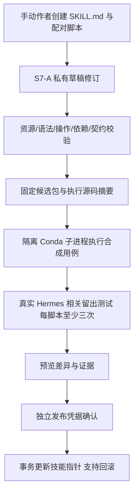
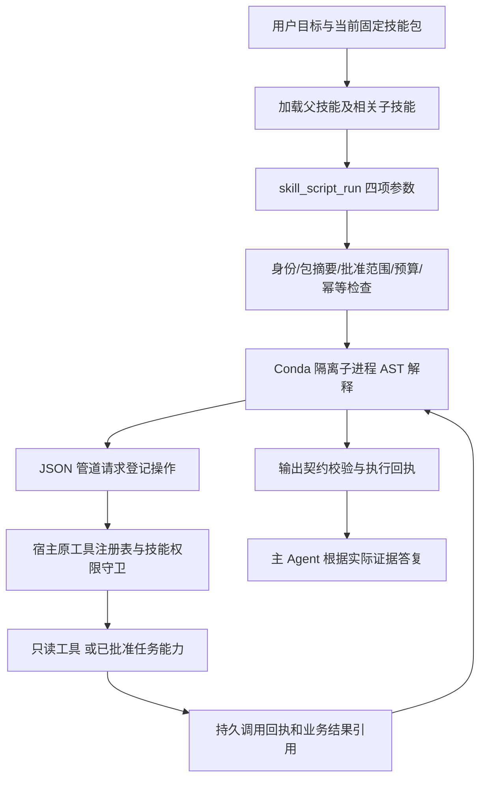

开发纪律与地址（开发前，2026-10-28）：服务器 `/home/h3c/project/python/scat-hermes-platform` 优先，仅已有 Anaconda scat-agent/scat-hermes/scat-rag-train，本机 base 传输、scat-frontend 静态检查；禁止 venv/uv、新环境和技能触发装依赖。暂存只在两端项目 `.tmp/s7b` 及受控原子同步目录，执行暂存在项目 `.tmp/skill-scripts` 并随调用清理；正式证据 `var/validation/20261028-s7b`。密钥仅服务器，原始业务数据不外发。

服务地址：保留核心18120、主Hermes18121、动作/MCP18123、作者API18124、手动作者18125、worker18126/控制18122/任务18128；保留RAG18133/旧18081、Honcho18140/Embedding18141/代理18142、Mongo27017及GBAR私网3000。隔离验证预留18148–18150，启动前核查。S7-B执行器通过进程管道通信，不新增监听端口。前端继续暂停。

# S7-B 技能附属脚本

本轮实现受限 Python 薄脚本，而非任意 Python 运行入口。技能脚本只做 JSON 参数校验、条件、有界循环、结果整理和已注册操作编排；新算法、数据库、外部服务能力仍先登记平台工具。受限语法通过 AST 解释器执行，不使用 eval/exec，不把静态扫描当成任意代码沙箱。

技能资源采用 `scripts/<name>.py` 配对 `scripts/<name>.json`。JSON 侧文件声明运行时版本、输入/输出 schema、操作清单与合成用例；全部资源纳入已有发布包 SHA。缺失描述、未支持语法、未注册操作、脚本调用另一脚本、文件/网络/进程/依赖安装等一律拒绝。

原生 `skill_script_run` 只在部署显式启用时注册。它使用当前会话的可信运行和固定技能包，要求当前运行实际加载相关技能。父进程从已注册工具分派，不信任子进程提交的身份、解释器、路径或凭据；每个嵌套调用仍经过原技能权限和累计工具预算。后台效果仍须通过已批准任务、租约和既有幂等步骤，脚本不获得新增授权。

执行使用当前已核验 Conda 的隔离子进程（-I/-S/-B）、最小环境、项目内空工作目录、CPU/内存/输出/循环/步骤/墙钟限制。持久回执固定包/脚本/参数/策略摘要；重复请求返回原回执，冲突和 unknown 不重跑。脚本完成只代表解释器成功返回，不替代业务制品验收。

创作复用 S7-A 草稿、修订、校验、试跑、预览、独立发布/回滚。脚本候选必须额外通过受限运行时负例、实际子进程合成用例以及相关原生留出测试；仅静态通过或作者自带用例通过不能发布。自动经验学习默认仍只创建文档技能，不能借本轮自动扩大执行能力。

验收覆盖：语法与资源闭合、路径/环境/越权拒绝、调用者身份与技能加载、重复/并发/重启/unknown、资源上限、父子工具证据与预算、真实原生 Agent 调用，以及脚本候选试跑和发布门禁。本轮不解除此前累计模型预算封顶，不删除上轮待授权旧测试记忆，不修改运行 profile 的 AGENTS。

## 文件与调用约定

继续使用标准技能目录：`SKILL.md` 描述适用条件和流程，`scripts/<name>.py` 保存薄脚本，同名 `.json` 声明契约。无需为每个技能增加脚本。可复核的完整示例见 `docs/examples/s7b-flight-investigation/`；示例是工程编写的合成候选，不能宣称由经验学习自动生成。

运行时标识为 `scat-thin-python-json-v1`。文件只允许一个 `def run(inputs)`，支持 JSON 常量、变量、字典/列表、索引、比较、条件和有界 `for`；仅有 `call`、`get`、`len`、`append`、`range` 五个辅助函数。`append` 返回新列表，需要赋回变量。禁止 import、属性访问、文件/网络、进程、反射、递归、异常捕获、推导式、while、用户自定义辅助函数及依赖安装。它是受限的 Python 语法子集，普通 Python 脚本不能直接迁入。

描述文件必须包含 `version: 1`、`runtime`、`operations`、`input_schema`、`output_schema`、`cases`，不接受额外字段。`operations` 必须与源码实际使用的字面量操作完全相同，且位于本技能与固定版本依赖闭包的已登记操作内。对象 schema 禁止额外属性，字符串/数组/数值必须有界；不加载远程 `$ref`。每个技能最多4个脚本、每脚本1–8个合成用例，用例明确 inputs、逐次 calls（操作、参数、合成响应）和 expected。

Agent 调用只接受以下四项，身份、发布包、解释器和工具凭据由宿主绑定：

```json
{
  "skill": "s7b-flight-investigation",
  "script": "scripts/investigate.py",
  "inputs": {
    "batch": "SYNTH-S6-HOLDOUT",
    "callsign": "QA601",
    "search_limit": 1,
    "track_limit": 2
  },
  "request_id": "a8a7bcb8-36f9-4b21-8bf2-e7295cdbf902"
}
```

实际业务必须使用当前用户参数或真实工具返回的标识。重复同一执行保留 request_id；相同 ID 改参数拒绝。新会话/运行有独立命名空间；后台任务跨代次仍绑定原批准任务，不能靠重启或换 UUID 绕过 unknown。恢复仅围栏同一后台任务，不影响共享数据库中的其他运行任务。

## 配置与资源

主服务/worker 需由维护者显式配置 `SCAT_SKILL_SCRIPTS_ENABLED=1`，或手动启动使用 `--with-skill-scripts`；作者角色不能直接执行脚本。受信任配置 `config/skill-scripts-policy.json` 可调整资源阈值，并纳入源码/任务/试跑摘要。配置变化后必须重新试跑，不能沿用旧证据发布。

| 默认限制 | 值 |
| --- | --- |
| 同一运行的脚本执行数 | 4 |
| 每脚本工具调用 | 12，另受父运行累计预算约束 |
| AST 执行步骤 / 累计循环次数 | 2000 / 64 |
| 墙钟 / 子进程 CPU | 120秒 / 2秒，墙钟同时受父运行截止时间约束 |
| 子进程地址空间 | 256 MiB |
| 输入 / 输出 / IPC 单帧 | 32 / 64 / 256 KiB |
| 单库持久回执容量 | 10000，容量到达时拒绝新增 |

墙钟超时会终止解释器；已经进入宿主工具的调用仍按工具自身超时、批准快照与租约收敛，不能把杀死解释器等同于取消业务效果。结果不明确时保留 unknown，阻止自动重放，交由既有任务/业务回执核查。持久回执容量满后需要维护者归档，不能静默删除去重证据。

## 两条完整链路





## 当前验证与部署

最终源码三次原生留出均通过，实际完成父技能与三个子技能加载、读取描述、执行脚本、生成三条只读业务回执，数据参数和返回值通过原有可信断言。作者 API 在独立合成 catalog 中完成配对资源创建/校验、缺少发布凭据403、发布与回滚；正式业务技能包指针不变。首轮通过后修复共享任务库恢复隔离并重新完成三次验证，保留两轮记录。

最终完整回归 **1399 passed/1 skipped**（258.20秒），S7-B专项26 passed，19个Python文件Ruff通过。原生留出最终trial为 `051e7327506f4574af626933f02e88cf`，三次5.90/9.47/13.60秒；每次实际执行脚本并保留三条底层只读引用，小样本不作SLA保证。两轮真实验证共25次模型尝试、1917325保守准入单位，供应商实际输入/输出合计494196 token；累计账本70次/4520033保守单位，仍保持每日及累计240次/800万封顶。

已部署 `20261028-s7b-a8fc62d5d0d1`，七核心容器健康，主角色实际配置包含 `scat_skill_scripts`；后台控制服务向批准任务子进程传递开关。三类镜像95个执行相关文件摘要与最终试跑一致，分别实际验证受限子进程、重复回执与临时目录清理。上一版 `20261028-1276159c1aac` 及其Compose/镜像保留，可按原发布档案回滚。既有RAG、GBAR/BentoML、Honcho容器、三个宿主Conda history保持，自动学习调度已恢复。

正式技能包仍为 `f713ad1f165cb7ffeb0a324503a35697e643fa51e707d8f194ebd343e10c1d95`。合成脚本仅在隔离catalog发布/回滚，不是正式业务技能；正式使用需按上面的草稿→试跑→独立确认链路发布。此前已有的经验技能草稿因执行源码变化，发布前需重新试跑，历史通过记录不重写。前端继续暂停，不新增Key/依赖/监听服务。

首轮全量失败的后台日志明确为 `Approved implementation changed`：测试尚在运行时更新源码使快照不再一致，数值单元拒绝执行，100秒后保守返回待核实/重排。固定最终源码后完整重跑通过，保护规则没有放宽。另保留首次校验异常、隔离API探针相对路径、镜像探针入口及原生镜像业务依赖导入错误；镜像审计改用纯标准库哈希，不向原生镜像安装NumPy。

服务器 `.tmp/s7b` 与空脚本暂存目录已清理，644个测试符号链接仅解除链接本身，未跟随目标；本轮隔离监听关闭、测试进程0。本机未创建本轮暂存。正式合成catalog、回执与原始日志留服务器 `var/validation/20261028-s7b`；公开[验收元数据](validation/20261028-S7B-acceptance.json)与两轮合成原生报告同步本机。未操作上轮待授权旧Honcho测试记忆或运行profile的AGENTS，未解除累计预算封顶。
