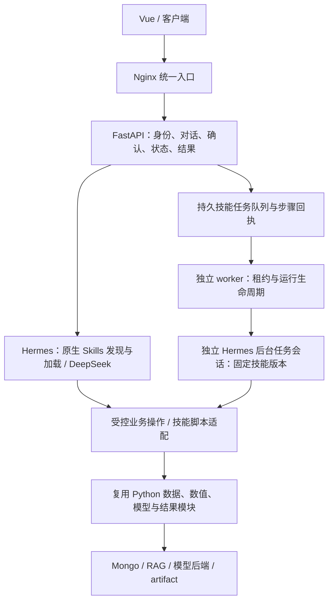

# Hermes Skills 核心业务执行方案与代码复用评估

> v2.5 当前状态：[S2 收口与验收](HERMES_S2_COMPLETION.md) 已完成本阶段只读基础、配置/单次额度、引用、模板/离线材料和题集。下一步 S3；模型制品、后台累计/恢复、归档、正式创作和 H6 配置页面继续分阶段实现。原章节与历史数据保留。

日期：2026-10-23。初始评估对应主计划 v2.0，后续七项规划对应 v2.2；第 13 节保留 v2.3 首步历史，当前 v2.5 收口见顶部专项链接。原评估数据、源码清单及历史估时保留，后续实施以主计划第 14 节为准。本文件中的目标设计不能视为全部运行功能已经实现。

## 1. 目标与“全部交给技能”的具体含义

新业务主链统一由 **Hermes 原生 Skills 负责选择流程、补齐参数、组织执行步骤、检查返回状态和生成分析结论**。查询、质量、轨迹、RAG、预测、对比、评估、物化和实验批处理都在迁移范围内；不只给现有十个工具各加一段说明。

技能包包含 `SKILL.md` 和按需引用的脚本、参考资料与模板，已有 Python 算法成为技能调用的执行资源。模型推理、数值计算、数据库访问仍在实际执行模块运行；不让语言模型用文字代替计算。共用模块留在 `src/`，技能脚本只作薄适配，避免在多个技能里复制算法。

目标主链不再由旧 LangGraph 主 Agent 或内部任务图决定业务步骤。**不会把整个旧模型图包装成一个技能工具后就宣布迁移完成。** H5 队列、确认和结果存储继续复用，worker 的图调用入口必须更换；旧图只在迁移期用于对照和受控回退，最终退出新请求主链。

业务执行是发起一次新的分析或计算；技能目录、任务状态、已有 artifact、健康检查等控制/历史读取仍可直接走 FastAPI。现有直接 REST 分析按钮改为发起技能运行，旧计算 REST/CLI 在切换前标记为兼容入口，完成覆盖后从普通用户主入口退出。不能一边保留默认绕过 Skills 的分析主链，一边称为“全部迁移”。

Hermes 官方描述了按需技能加载、技能资源和外部目录；Agent Skills 标准允许技能携带可执行脚本。这支持“技能组织流程、已有程序承担计算”的方案。[Hermes 官方技能说明](https://hermes-agent.nousresearch.com/docs/user-guide/features/skills/)；[Agent Skills 格式规范](https://agentskills.io/specification)。

**版本限制：** 项目仍固定 v0.22.3 / `5b147ab036d6d19131bff8d20701b5001eab844a`。官网是滚动文档，不能据此认为该提交已经具有所有最新接口。本轮主 SSH 初期两次超时，随后恢复，已只读核对该版本存在 skills_list、skill_view、skill_manage 和 external_dirs 解析，并保存 [源码检查记录](validation/20261023-hermes-skills-source-inspection.json)。S1 仍必须验证 API 入口实际加载、目录可见范围、调用上下文和 trace，源码存在不等于运行验收。不得静默升级，也不预设已存在 `/api/skills` 或 API 自动解析技能斜杠命令。

## 2. 现状：H5 是有价值的基线，尚不是 Skills 架构

| 现有部分 | 已验证能力 | 转向 Skills 要做的事 |
| --- | --- | --- |
| `scripts/run_hermes_api.py` | 精确十工具白名单、DeepSeek、独立 Conda、私有 HTTP/SSE | 增加已审核技能目录、原生列表/加载及技能身份记录，调整回合/成本预算 |
| `application/readonly.py`、`scat_mcp/server.py` | 五类只读查询、严格参数和输出预算 | 作为技能执行工具继续使用，覆盖更多 SCAT/UAV 查询能力 |
| `application/model_tasks.py` | 固定模型版本、准备快照、人工确认、按归属读结果 | 从 `agents/model_tools.py` 提取公共函数；增加技能/步骤快照与执行引擎标识 |
| `application/task_store.py` | SQLite 幂等确认、原子领取、心跳、unknown 阻断 | 复用事务语义，扩展技能任务/逻辑步骤回执；保留旧数据兼容 |
| `application/model_worker.py` | 独立执行，与 SSE/聊天解耦 | 当前调用 `_execute_persisted_model_run`，后者进入旧图；这是必须替换的主链入口 |
| `agents/model_agent/graph.py` | 验证、解析、准备、推理、评估的固定 LangGraph 流程 | 把可复用步骤提取为执行操作，旧图的顺序/分支交给 Hermes 技能 |
| `agents/analysis_results.py`、`analysis_runs/` | 结构化结果、run/artifact 与完整性/归属 | 保留实现，必要时移动到框架中性模块 |
| `scat/experiments/runner.py`、`scat/materialization/` | 实验、物化、恢复与评估 | 拆出计算和持久化；端到端业务调度进入对应技能 |
| Vue / ECharts / Cesium | 对话与 H5 确认控件、专业可视化组件 | 技能入口/执行轨迹及 H6 通用结果组织，继续保留旧七类展示基线 |

2026-10-22 的 811 项服务器、47 项本机相关 Python、96 项前端、10 项浏览器和受控真实闭环属于旧架构基线。它们不代表技能执行已验收，历史报告不回写。生产 GBAR 开关仍关闭，CPU 夹具通过不代表 V100 推理通过。

## 3. 目标结构与服务环境



这是目标架构图；本次没有新增这些运行组件。前台 Hermes 负责准备方案与交互；用户确认后，worker 调用同一私有 Hermes 服务，建立独立后台执行会话，按固定技能和批准的范围组织执行。后台会话与当前聊天分开，不能占用或污染用户的活动对话。

| 服务 | 环境 / 保留内容 | 职责变化 |
| --- | --- | --- |
| Nginx / Vue | 现有 Nginx；Node 24 / npm 11 构建 Vue | 入口不变；后续新增技能选择、轨迹与结果组织 |
| 平台与 worker | `scat-agent` Conda / Python 3.12 | 平台做身份/授权，worker 做持久运行生命周期；不导入 Hermes 3.14 依赖 |
| Hermes 前台/后台执行 | `scat-hermes` Conda / Python 3.14 | 同一私有服务建立隔离会话，实际按原生技能组织流程 |
| 技能业务操作 / 脚本 | `scat-agent` Conda 或既有模型独立 Conda | 通过已注册操作或受控脚本入口调用共享实现 |
| RAG / GBAR | 既有独立服务/环境，权重仍在 `/mnt` | 保留模型、预处理和评估身份，另行 GPU 验收 |
| 状态与数据 | SQLite / Mongo；项目内受控运行目录 | 复用 H5 状态语义，增加中间制品引用与步骤回执 |

不新增项目 venv，不修改已有 Conda，不为技能框架重下权重。Compose 继续放 H7，需挂载同一技能发布包与持久状态；单机 SQLite 不能直接推广成跨主机队列。宿主阶段复用 Conda CLI 桥；H7 分容器时改为私有 MCP/HTTP 动作服务，由业务容器执行脚本，避免 Hermes 容器依赖宿主 Conda 绝对路径。

建议目标目录（**尚未创建**）：

```text
skills/<业务技能>/SKILL.md          工作流、适用条件、步骤、失败处理、结果要求
skills/<业务技能>/references/       指标口径、协议和操作说明
skills/<业务技能>/scripts/          可选的薄适配脚本，复用 src，不复制算法
skills/<业务技能>/assets/           报告/布局模板，输出仍受版本化协议校验
services/hermes/skills.lock.json    已审核的技能版本、文件摘要、依赖和允许操作
src/hermes_runtime/skills.py        原生技能集成、发布身份与可信加载 trace
src/application/skill_jobs.py       技能任务、授权快照及步骤回执适配
src/application/model_steps.py     从旧图/工具提取的模型阶段操作
src/scat_model_runtime/             保留模型协议、算法与后端
src/analysis_runs/                  保留最终 run/artifact
```

优先使用原生 `skills_list` / `skill_view`。固定版目录发现不满足要求时，以审核发布包部署到独立 HERMES_HOME 的技能目录；具体方式由 S1 实测决定。技能内容进入版本管理，业务会话先只读加载，S1–S6 的业务运行配置只读；后续 S7 通过独立草稿/测试/发布流程开放 Agent 自主创建与修改，详见 [技能生命周期与工具映射](HERMES_SKILLS_LIFECYCLE_AND_TOOL_MAPPING.md)。固定版 skills 工具组同时注册了 skill_manage，不能直接启用整个工具组就认为只开放读取；需要限定实际工具集合。源码还显示 skill_view 默认 preprocess=True，可作内联 shell 预处理；即使设 False，非空 deps 仍可能触发 pm.ensure。S1 应对审核发布包进行入场校验，原生加载适配固定 preprocess=False、拒绝自动 deps，并测试“加载无命令执行/依赖安装”。原生 usage 计数属于允许的运行态元数据，不等于修改技能内容。`allowed-tools` 或说明文字不能替代服务端实际权限检查。

## 4. 技能拆分与全业务覆盖

| 目标技能 | 业务范围 | 主要复用来源 |
| --- | --- | --- |
| `scat-flight-query` | 数据集/批次发现、检索、航班详情、机场统计 | SCAT Service/Repository、现有查询工具 |
| `scat-data-quality` | 批次与模型输入质量、问题/干净样本筛选 | quality、preprocessing、quality tools |
| `scat-trajectory-analysis` | 原始/计划轨迹、截面、阶段、预测快照 | SCAT 轨迹服务、FPL、phase 等协议 |
| `aviation-knowledge` | 术语、指标口径和文档引用 | KnowledgeSearchService 与独立 RAG |
| `scat-model-prediction` | 选模型、准备输入、确认、推理、评估、保存 | model registry、resolvers、packages、backends |
| `scat-model-comparison` | 固定共同样本/时间轴，组织各方法并对比 | comparison、alignment、评估和汇总内核 |
| `scat-evaluation` | 误差统计、阶段评估、最差样本、报告读取 | eval tools、prediction metrics 与结果构造 |
| `scat-materialization` | 准备、确认、生成派生数据、查询/核验 | materialization tasks/jobs/repository |
| `scat-experiment` | 批处理实验、分组、状态、报告与受控发布 | experiments contracts/evaluation/grouping/repository |
| `uav-analysis` | UAV 样本、通道、异常/阶段统计和已注册任务 | UAV Service/Repository 与模型协议 |
| `aviation-report` | 组织文字、指标、表格、轨迹、图表与后续修改 | AnalysisResult、Vue/ECharts/Cesium；展示交付留 H6 |

本轮静态找到旧 LangChain **52 个 `@tool` 定义**，逐项见机器清单。它们是覆盖检查来源，不代表应把 52 项全部暴露成可调用工具：prepare/状态/结果可以复用；submit/确认能力按服务端授权重新划分，不能交给未确认的聊天执行。已有五只读 MCP 加五任务工具只是第一批执行资源，物化、实验和其余查询必须继续迁移。

## 5. 模型任务如何摆脱旧内部图

将旧图的 validate/resolve/prepare/execute/evaluate/complete 拆分为有契约的阶段操作。业务技能决定选择哪些已允许阶段、如何组合分析与如何解释结果；每个操作内部复用原 Python 实现。

| 阶段操作（拟定，不是现有接口） | 允许的行为 | 返回 |
| --- | --- | --- |
| 准备输入 | 核对批准的数据范围，解析并按既有版本处理 | 受归属控制的输入制品引用、点数和摘要 |
| 执行注册模型 | 检查模型/后端身份与阶段幂等键，提交一次真实计算 | 后端 job/预测制品引用、执行是否已核实 |
| 执行评估 | 使用固定样本、时刻与评估器计算 | 指标制品和单位/口径 |
| 汇总模型对比 | 检查各结果使用同一协议，再汇总 | 对比制品，不由 LLM 手算误差 |
| 保存结果 | 校验制品归属和完整性，构造 AnalysisResult | run/artifact 引用与可追溯来源 |

预处理—模型—后处理若是模型包不可分的数值约定，保留为一个确定性计算操作；不为增加技能步骤而拆坏数值协议。对比包中固定的数学口径可保留，跨模型/跨任务的业务流程由技能组织。`agents/model_tools.py` 中 `_model_summary`、`_new_analysis_run`、结果持久化等应移到中性应用模块，不能让新技能模块永久依赖整个旧工具层。

中间张量和全量轨迹不进入 LLM 上下文。增加版本化输入/预测/评估制品引用；数据持久到项目受控制品目录或业务存储，权限和摘要在元数据中校验，模型只能使用对象 ID，不接受任意路径。现有 AnalysisResult 用于最终结果，不能假定它已经能存任意中间模型输入。

## 6. 确认、后台恢复和一致性

继续保留用户此前确定的人工确认规则。物化/实验允许的写入限定为派生集合、任务与结果记录，原始航迹仍只读；不增加任意数据库写入能力。技能可生成待确认方案，但准备本身不执行 GPU/写入型业务。后台执行时持有服务端产生的批准上下文，已确认操作在限定范围内执行，不逐步反复打断用户。

准备快照须新增：skill_id、技能版本及整个发布包哈希、执行引擎/协议版本、允许的业务操作与预算、数据范围、模型/预处理/评估器版本和参数。发生范围或版本变化必须重新准备和确认。技能来源、实际加载、执行步骤和最终数据引用均从可信加载器/工具回执记录，不能仅相信模型声称“已使用技能”。

| 情况 | 目标处理 |
| --- | --- |
| 同一逻辑步骤重复调用 | 服务端稳定 step_key 返回既有回执，不重做计算 |
| Hermes 原生工具未传 tool_call_id | 沿用 H5 实测经验，不把它作为幂等前提；使用 job/阶段/规范化参数与制品引用 |
| worker/HTTP 断线、原生 run 接收结果未知 | 先查原生运行及步骤回执，不能换新 ID 再执行 |
| GPU 已开始但结果未知 | job/step 标记 unknown，禁止自动重跑；人工核实外部后端 |
| worker 租约失效而 Hermes 仍在运行 | 每次效果操作校验服务端租约代次和批准上下文，旧执行者不能再发起新步骤 |
| 页面刷新、关闭对话或重启 FastAPI | 后台会话、job、run/artifact 按权限恢复，不依赖聊天连接存活 |
| 技能/脚本在确认后被修改 | 哈希/版本不符，拒绝继续新效果操作，重新准备；不隐式使用新包 |
| 随机采样/实验批处理 | 固定 seed/抽样方法及最终样本清单；确认后不能由 LLM 重新挑样本 |

Hermes 重试不等于 GPU 步骤可重试。旧 H5 仅有整任务幂等，尚未实现以上逐步骤回执/租约代次；这是 S4 的新增工作，不能把 SKILL.md 当成持久任务引擎。

迁移新增带 execution_engine/schema_version 的任务协议或独立技能任务存储；旧 H5 行默认属于 legacy_graph，不能把旧 queued/unknown 直接改成技能任务。切换前排空旧 worker 并核实无未决 GPU；旧只读 run/artifact 继续兼容。需要双引擎并存时必须先建立共同资源准入，不能依靠两份 SQLite 各自的单并发锁控制同一 GPU。

## 7. 代码复用数量与可信范围

范围：`src/**/*.py` 和 `frontend/src` 下 `.ts/.vue`；排除测试、生成类型/JSON、vendor、依赖、构建产物及 `scripts/`。7 个语音文件、581 个非空行单列为当前范围外。其余 **229 个文件、45,696 个非空行** 构成本次分母；非空行包含注释/docstring/模板，不能视为可执行 LOC 或工时。

| 归类 | 文件 | 非空行 | 占本次分母 | 含义 |
| --- | ---: | ---: | ---: | --- |
| 保留能力候选 | 148 | 26,331 | 57.62% | 算法、数据/结果契约、仓储、身份基础、可视化；可能移动文件/改 import |
| 拆分适配 | 51 | 13,695 | 29.97% | API、应用服务、H5 worker/队列、旧工具、部分物化/对比与页面 |
| 流程替换 | 10 | 2,780 | 6.08% | 旧 Agent、模型/实验图、实验 runner 等主流程 |
| 旧入口退役 | 20 | 2,890 | 6.32% | 旧 Streamlit、AG-UI、旧客户端/检查点等，迁移期间仍保留 |

**结论：基础执行能力大部分可继续使用，主要重做业务编排与执行适配。** 约 58% 的源码体量列为保留候选，约 30% 需要拆分适配，约 12% 属于旧流程/入口替换。不能把前两项相加后宣传为“88% 无需修改”，也不能说已经验证新架构复用率；最终修改比例需在迁移后统计。混合模块按整文件列入适配，部分旧图纯函数仍可能进一步复用。

| 核心代码 | 判断 | 原因 |
| --- | --- | --- |
| `scat` / `uav` 数据仓储、schema、主要 Service | 高复用 | Hermes 技能仍需相同的数据读取与计算 |
| `gbar_core`、模型适配/后端、预处理、指标内核 | 高复用 | 更换调度入口不改变张量、时间轴和数值定义 |
| `analysis_runs`、AnalysisResult 与结果构造 | 高复用 | 保留归属、版本、完整性和七类结果协议 |
| RAG 与模型权重 | 高复用 | 技能调用既有服务；权重不搬进技能包 |
| H5 确认、状态、worker 基础 | 复用后适配 | 保留规则与事务；增加技能身份与步骤级语义 |
| Hermes HTTP/SSE、MCP 与原生业务工具桥 | 复用后扩展 | 新增原生技能加载/trace/后台任务上下文 |
| Vue/ECharts/Cesium | 组件高复用，页面适配 | 增加技能入口，既有图形与结果展示基础保留 |
| LangGraph 主/内部流程与旧提示词 | 主流程替换 | Skills 必须成为实际业务流程拥有者 |

逐文件路径、理由、非空行、源码 SHA256 和 52 个旧工具名称见 [机器清单](validation/20261023-skills-reuse-inventory.json)。本轮不改这些源码；后续可按 SHA 检查评估依据是否变化。

## 8. 修改后的开发顺序与工作量

H1–H5 的历史验收保留；增加 S1–S6 作为 H6 前的必经迁移阶段。先改执行主链，再接完整动态展示。

| 阶段 | 交付 | 验收重点 | 初估人日 |
| --- | --- | --- | ---: |
| S1 原生技能与固定版本验证 | 原生列表/受控加载、已审核目录/摘要、禁止预处理命令与 deps 安装、一次真实技能 | 实际 skill_view/加载 trace、限定技能可见范围、既有十工具边界、DeepSeek 成本/回合预算 | 1–2 |
| S2 查询/RAG/轨迹/UAV 迁移 | 业务技能与旧查询/质量/评估工具覆盖矩阵 | 同数据同契约结果一致，普通分析从技能入口发起，不凭输出文字判成功 | 2–3 |
| S3 模型步骤提取 | 中性模型服务、输入/预测/评估制品契约、技能包 | 流程从旧图退出，算法数值、单位、版本与现有实现一致 | 2–3 |
| S4 技能后台任务执行 | worker 调 Hermes 独立 job，会话/批准范围/步骤回执/恢复 | 人工确认、重复步骤、失联/unknown、租约过期、重启恢复、技能变更拒绝 | 2–3 |
| S5 物化/实验/报告覆盖 | 写入型流程、批处理、固定样本、最终报告技能 | 旧 52 工具用途逐项有迁移/合并/控制面处理说明，不能漏掉尚未开放能力 | 2–4 |
| S6 全链路对照与切换 | 场景题集、旧入口退出、历史结果兼容、文档 | 正常请求不调用旧业务图，全部核心场景经 Skills 实际执行，原有边界不退化 | 1–2 |

新增迁移合计 **10–17 人日**，是基于现有代码结构的单人估算，不是工时承诺；S1 后按固定版本验证结果调整。只让现有十工具被技能组织会更快，但不构成本次“全部核心业务”的完成标准。H6 通用展示、H7 Compose/正式入口、H8 交付，以及生产模型制品准备、GPU 驱动/真实推理验收单独计算。

## 9. 新架构验收必须补充的证据

- 对每类核心场景记录实际加载的技能身份、内容摘要、业务步骤、参数及结果引用；技能加载失败不得伪装成功或静默回旧图。
- 对旧注册工具和各业务域建立覆盖表，说明复用操作、合并方式、是否有写入/确认及测试位置。
- 同一输入、模型身份和评估协议下对照现有确定性数值结果；不能只断言最后回答有“成功”。
- 查询空结果、分页/体积上限、越权、RAG 引用、坏参数、工具失败等原边界继续覆盖。
- 一份 GPU 任务重复 tool call、网络未知、进程中断后至多产生一份执行；未知状态不得自动重跑。
- 实测后台 Hermes 的原生 run/session 与用户聊天隔离、可信上下文传递及 FastAPI 重启恢复；原生能力不足时先补适配再计完成。
- 报告技能用已有受归属控制的数据组织块；H6 继续逐项对照旧 Streamlit 的七类结果和原交互，保留多轮调整能力。
- 初期受控 CPU 模型证明流程，启用真实 GBAR/V100 后单独验收性能和数值；不能把 CPU 流程测试写成 GPU 完成。

## 10. 方案评估记录（S1 实施前）

方案评估阶段修改开发方案和文档、保存 v1.8 原始快照、产生逐文件复用清单，并核查文档链接/数字/源文件摘要。没有创建业务技能包、修改启动白名单、运行 GPU、安装依赖或发布服务。当时 Skills 功能尚待 S1 实施；后续实际进度见第 11 节，旧 H5 运行方式继续有效。远端源码与文档同步结果单独在本轮检查记录中说明。


## 11. S1 实施与后续自主创作补充

前述“尚未创建/待实现”为方案评估时状态。2026-10-23 已完成 S1 的发布清单、两个首批技能、受控原生读取与 profile 快照验证；真实模型使用合成 MCP，真实数据留服务器内验证，当前测试状态见 [S1 专项](HERMES_S1_NATIVE_SKILLS.md)。完整业务迁移与任务级版本绑定仍按 S2–S6 实施，自主创建/修改按 S7 独立生命周期实施。

## 12. v2.2 详细规划补充

用户已同意七项优化，具体任务、交付、配置键与验收以 [主计划第 14 节](../SCAT_HERMES_PLATFORM_DEVELOPMENT_AND_TEST_PLAN.md#skills-detailed-plan) 为准：S2 落实运行级技能/操作绑定和组合契约；S3 保留粗粒度业务操作；S4 优先完成可恢复 CPU 最小闭环；S2–S6 贯穿任务完成与稳定性评测；自主创作材料从 S2 准备、正式作者服务仍留 S7；容量/归档/会话/缓存/轮次/token/时间/费用预算由用户配置并经服务端校验。

第 8 节的 10–17 人日是 v2.0 历史初估，不能作为扩展范围后的承诺；S2 契约确定后更新清单，S3/S4 首条可恢复链路通过后再估剩余工作。H6/H7/H8、S7 正式能力和真实 GPU 仍分别排期。创建和调用完整目标流程图见 [生命周期文档](HERMES_SKILLS_LIFECYCLE_AND_TOOL_MAPPING.md#skills-workflows)；本轮未实施这些新增运行能力。

## 13. v2.3 S2 首步实施

已在服务器实现 Skills profile 原生工具分派的运行级技能准入与审计，操作关联实际正文加载的版本、摘要、load_id 和可信 scope/run/session。原生 handler 重新注册仍受拦截，未发布适用技能的操作明确拒绝，控制/历史读取沿用原授权；旧 H5 默认入口未切换。两端相邻回归各 62 项，服务器全后端 864 passed/1 skipped，两套 Conda pip check、固定版原生探针与真实 DeepSeek+合成 MCP 验证通过。具体范围、结果和剩余任务见 [S2 首步记录](HERMES_S2_SKILL_OPERATION_BINDING.md)，全域/组合/配置与后台恢复继续按主计划推进。
