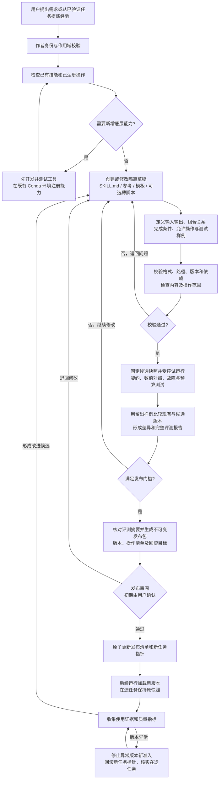
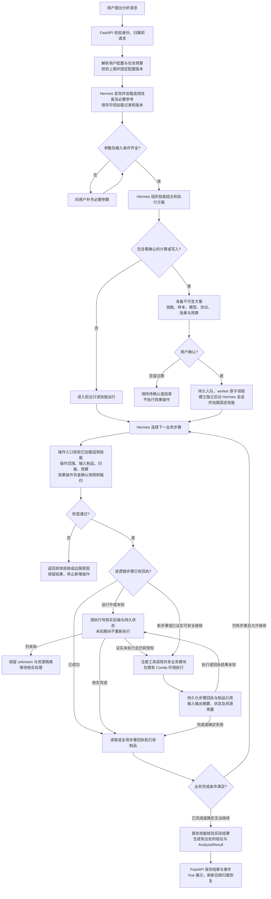

# 技能生命周期、工具边界与后续自主创作

> v2.5 当前状态：[S2 收口与验收](HERMES_S2_COMPLETION.md) 已完成本阶段只读基础、配置/单次额度、引用、模板/离线材料和题集。下一步 S3；模型制品、后台累计/恢复、归档、正式创作和 H6 配置页面继续分阶段实现。原章节与历史数据保留。

> 版本：v1.3；日期：2026-10-23。七项优化沿用主计划第 14 节；[S2 首步操作绑定](HERMES_S2_SKILL_OPERATION_BINDING.md) 为历史范围，v2.5 当前阶段状态见顶部专项链接。下列完整创建/调用流程仍为分阶段目标，不能将其余 S2–S7 能力视为已开放；S1 历史验收状态保持不变。

## 1. 目的与分层

核心业务流程交由 Hermes 技能组织；数据读取、真实数值计算与效果操作由有明确输入输出的工具完成。工具可复用 Python Service/Repository/模型内核；技能负责目标、条件、顺序、分支、结果检查、解释及多轮调整。一个工具可以包含不可分的预处理—模型—后处理数值约定，不为了增加技能步骤而拆坏数学协议。

底层坐标转换、对齐、指标计算等继续是工具内部函数，无需全部注册给 LLM。身份、凭据、任务确认、队列、租约、幂等、恢复和发布权限由平台落实，不能由技能文档重新定义。技能允许操作清单是发布校验材料，不替代服务端权限检查。

## 2. 原项目功能如何拆分

| 业务 | 可复用为工具的操作与现有来源 | 技能组织的工作 |
| --- | --- | --- |
| 航班/批次查询 | list_scat_batches、search_scat_flights、get_scat_flight_overview、get_scat_batch_overview、get_scat_track_points | 理解条件、补充必要参数、缩小范围、组织分页及后续查询 |
| 数据质量 | inspect_scat_collection_data_quality、问题/合格航班列表、inspect_scat_model_data_quality | 判断输入适用性、选择筛选方案、说明范围和限制 |
| 轨迹分析 | 实际/计划轨迹、预测截面、飞行阶段、机场/阶段统计 | 组织对照、定位异常时间段、结合阶段解释 |
| 航空知识/RAG | search_scat_knowledge 与既有检索服务 | 选择检索词、结合实际业务数据解释、引用真实 source_id |
| 模型预测 | 模型目录、输入准备、执行注册模型、评估、保存/读取制品 | 选模型、补参数、生成待确认方案、按批准范围组织执行和解释 |
| 多模型对比 | 各模型/基线计算、共同时间轴对齐、固定口径评估及汇总 | 决定对比问题、固定共同样本、组织方法和结果解释 |
| 误差诊断 | get_prediction_metric_summaries、get_worst_prediction_cases、阶段误差/分段读取 | 按场景诊断、选择后续调查、形成结论；LLM 不手算指标 |
| 数据物化 | prepare_materialization_job、状态/结果、重新划分授权后的执行操作 | 设计派生范围、准备确认、跟踪和核验；原始数据保持只读 |
| 批量实验 | prepare_prediction_experiment、实验状态/分组/结果、受控执行 | 固定实验样本和 seed、安排批次、检查完整性、总结报告 |
| UAV | 航班/通道/样本检索、异常及阶段统计、已注册模型操作 | 选通道、定位区间、比较正常与异常、组织解释 |
| 报告展示 | 读取制品、校验/保存结构化 AnalysisResult、查询结果引用 | 选择图表和表格、组织标题文字、按对话调整布局和筛选；Vue/ECharts/Cesium 执行渲染 |

旧 52 个 @tool 定义作为迁移覆盖清单，不等于 52 个技能或全部可开放工具。submit/confirm/cancel 等须逐项按效果和授权划分；不能把旧函数原样批量注册到聊天工具列表。模型阶段提取后退出旧 LangGraph 主/内部业务图，不能以技能包裹整图冒充迁移完成。

例：“比较某批次 GBAR、Kalman 和匀速模型误差并生成报告”是技能；数据发现、质量筛选、输入制品准备、各模型计算、同口径评估和结果保存是工具。身份与任务确认仍由 FastAPI/平台控制。

## 3. Agent 自主创建与修改技能

Hermes 固定源码具有 skill_manage；当前先开放受控 skills_list/skill_view，后续通过单独创作能力接入写入，不整体开放原生 skills 工具组。官网滚动版本中的 /learn、write_approval、create_dir 等设置不能直接当作固定版验收结论。

目标流程：提出需求或总结已验证经验 → 创建/修改草稿 → 校验格式、引用和依赖 → 固定样例试运行与回归 → 发布版本 → 后续任务使用 → 可回滚。Agent 可自主反复编辑与测试草稿；发布与执行任务确认分别管理，不要求每次草稿修改都打断用户。

| 创作层次 | 实现边界 |
| --- | --- |
| 流程说明、参考资料、报告模板 | 优先实现；在已有已注册工具范围内重组业务 |
| 复用既有 Python API 的附属脚本 | 增加静态校验、测试与受控执行；脚本不能任意访问路径或增加权限 |
| 新算法、新数据库操作、新外部能力 | 先开发、测试和注册工具，再允许技能引用；技能文字不能自行授予能力 |

技能只保留可泛化步骤、适用条件与经验，不写入 API Key、数据库凭据或整段用户私有对话。知识检索/工具返回中的文本不能直接成为新技能的可信指令；候选内容也需通过发布检查。

## 4. 版本、归属与运行一致性

- 技能有稳定 skill_id、版本、整个发布包摘要及逐文件摘要；每次加载产生可信来源记录。
- 草稿与已发布版本分离。修改来源文件不会替换运行中的快照；发布新版本后由新会话/新任务使用。
- 已确认任务绑定批准时的技能包、模型/预处理/评估器版本、数据范围和允许操作；不能执行到一半换技能。S4 才实现完整任务快照与步骤授权，本轮 S1 只实现运行 profile 技能快照及加载回执。
- 初期发布采用用户确认，后续可对限定工具组合、通过回归的低影响修改按策略自动发布；新增效果操作/脚本执行能力单独准入。
- 后续多用户区分私有草稿、个人发布技能与共享技能库。owner/thread 来自可信服务端上下文，不能从模型传参推断身份；共享发布另有权限。
- 作者运行配置与业务运行配置分离；业务配置不能直接调用 skill_manage、终端、自动安装器或任意文件写入。

## 5. 目录与阶段

现有 S1：skills/<name>/SKILL.md 及 references，services/hermes/skills.lock.json，src/hermes_runtime/skills.py；运行 profile 下 skills/ 为校验后的独立快照，skill-loads.sqlite 仅记录加载身份、版本、文件与摘要。

后续 S7 拟增加：var/skill-authoring/drafts/<owner>/<draft_id>/、独立创作 API/配置、草稿检查和试运行服务、发布/回滚记录。目录与 API 尚未创建。开发与测试仍统一使用本机和服务器 Anaconda，项目内不建 venv；源码、临时文件、缓存、日志和状态留在新项目内。

S1 预留发布身份与不可变快照；S2–S6 完成全部业务迁移与覆盖。v2.2 从 S2 提前准备草稿格式、样例与离线评测，S3–S5 积累经验证的候选改进，S6 完成留出样例对照。正式作者 API、草稿管理、发布和回滚仍在 S7 实施，S7 不作为 H6 前置；脚本创作分为 S7-B 单独验收与估时。七项优化、技能组合契约及用户可配置的容量/预算见 [主计划第 14 节](../SCAT_HERMES_PLATFORM_DEVELOPMENT_AND_TEST_PLAN.md#skills-detailed-plan)。

S7 验收：草稿增改不影响已发布技能；非法工具/依赖/路径不能发布；固定样例对照业务结果；发布可追溯且可回滚；运行中任务不换版本；私有技能无跨用户泄露；自主修改不能绕过确认或获得新效果能力。

## 6. 依据

- [Hermes 官方技能文档（滚动版本）](https://hermes-agent.nousresearch.com/docs/user-guide/features/skills)
- [固定版源码核查](validation/20261023-hermes-skills-source-inspection.json)
- [架构与代码复用评估](HERMES_SKILLS_ARCHITECTURE_AND_REUSE_20261023.md)
- [S1 实现与验收记录](HERMES_S1_NATIVE_SKILLS.md)

## 7. 完整目标流程图（v2.2）

以下分别描述技能从需求到发布的创建链条，以及用户请求到业务结果的调用链条。发布确认和业务执行确认分别管理；已通过 S1 不代表这两条完整链路已经实现。

### 7.1 Skills 创建、修改与发布链条

草稿可由 Agent 自主反复编辑、校验和试运行；试运行只能使用已授权的隔离数据/注册工具，付费模型调用受预算控制。薄脚本还需静态检查和受控执行验证；创建草稿不会授予任意文件、终端或数据库权限。S2–S6 先实现开发期材料与评测入口，S7 再实现完整作者服务。

### 7.2 Skills 调用与业务执行链条

技能正文加载失败时返回明确错误，不能静默回旧图。图中目录/加载调用也计入运行预算；所有节点错误均应记录可查询状态。对确定失败，Hermes 只能在原批准范围与剩余额度内选择替代步骤；扩大效果范围、换模型/样本/技能快照则回到重新准备。结束时保存成功、部分结果或失败的实际状态，不能以报告文字掩盖未知/失败步骤。

后台恢复从持久 job/步骤和实际后端状态出发，新 Hermes run 继续使用原批准快照及累计预算；聊天历史不决定是否重算。停止对话仅停止对话，任务取消需请求并核实后端；预算达限也不会自动重跑或假定已开始的外部计算停止。H6 完整展示、H7 常驻部署以及真实 GPU 按各自阶段验收。
